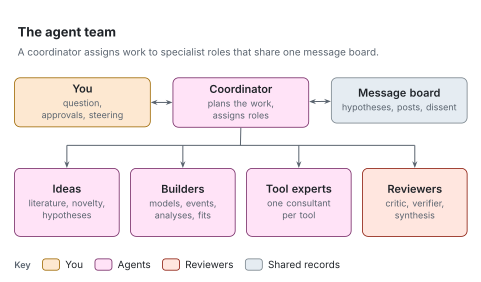
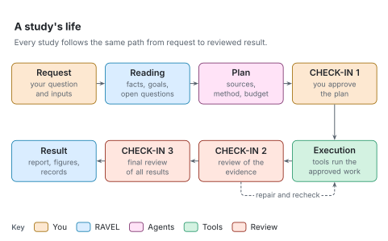

# RAVEL

RAVEL is an agent-driven research system for high-energy physics. You ask a physics question in plain words; a team of AI agents plans the study, runs established physics tools and reviews the evidence, and you approve each major step.

You get a reviewed result: numbers with their uncertainties, publication-style figures and a report, with every value linked to the inputs, tool versions and decisions that produced it.

[Install](#install) · [Start a study](#start-a-study) · [What RAVEL does](#what-ravel-does) · [Toolchain](#toolchain) · [How it works](#how-it-works) · [Documentation](#documentation) · [Cite](#licence-and-citation)

<a id="1-check-the-installation"></a>

## Install

```bash
git clone https://github.com/ammarphp/ravel.git
cd ravel
bash scripts/setup/install.sh
.venv/bin/ravel doctor
```

The installer brings its own Python, needs no administrator rights and resumes a failed step where it stopped.
<!-- ravel:disk:start -->
The default installation needs 47.9 GB of disk space.
<!-- ravel:disk:end -->
The installer plans about 8 hours for the default toolchain; `bash scripts/setup/install.sh --dry-run` prints the size and time of each part before anything changes.

The symbolic tools use your Wolfram Engine or Mathematica licence. The [installation guide](docs/installation.md) covers the licence, the analysis-facility target and model-provider setup.

<a id="quick-start"></a>
<a id="2-compute-a-first-limit"></a>
<a id="3-ask-a-coding-agent"></a>
<a id="working-with-a-coding-agent"></a>
<a id="commands"></a>

## Start a study

Open the checkout in your coding agent and describe your question, for example: *"Fit the Higgs coupling modifiers to the published Run 2 measurements and show the 68% and 95% regions."* The agent writes the study specification and drives the commands below. You can also run them yourself with your own [specification](docs/workflow/reference/scoped-workflows.md):

```bash
source .venv/bin/activate
ravel initiate --prompt "Your physics question" --out studies/my-question
ravel status --rundir studies/my-question --write
ravel plan --rundir studies/my-question --spec study.json
ravel approve --rundir studies/my-question --quote "Approved as planned."
ravel run --rundir studies/my-question
```

What happens:

1. **Plan.** The agent reads your question, gathers the papers, data and code it needs, and writes a plan with its assumptions and a compute budget. `ravel status` shows the next step at any point.
2. **CHECK-IN 1.** You read the plan and approve it in your own words, change it, or ask questions. The supervised launch starts heavy work after this approval.
3. **Work.** The agents run the approved tools, build any missing analysis code or models, and report progress. You steer at any time, or delegate approvals to an agent within limits you set.
4. **Review.** Independent reviewer agents check the evidence. Objections send the work back for repair and a fresh check.
5. **Result.** You receive the reviewed numbers, figures and report, checked against your original question.

<a id="supported-analyses-and-statistics"></a>

## What RAVEL does

- **Collider studies and reinterpretation.** Generate and simulate signal events, run public analysis code or build new analysis routines, reinterpret published searches for new models and scan parameter planes.
- **Higgs and Standard Model measurements.** Fit couplings and signal strengths, compute ratios and normalised cross sections, and compare predictions with published measurements.
- **Models and theory calculations.** Compute spectra and decays, enumerate and draw Feynman diagrams, translate effective-field-theory coefficients and evaluate loop integrals.
- **Statistics.** Set 95% CLs exclusion limits or the statistic you prescribe, run likelihood fits and profiles, combine channels and reuse published likelihoods.
- **Cosmology.** Compute power spectra and infer cosmological parameters.
- **Open-ended research.** Survey the literature, propose and test hypotheses through staged experiments, and write up results as reports.

Every operation in this release:

<!-- ravel:capabilities:start -->
- A FeynRules model extending the Standard Model, rendered from a typed model specification.
- A declared literature census and published-limit overlay.
- A native analysis-routine port on flat reconstructed ntuples through a supplied branch and flag map.
- An enumerated diagram population passed to its declared consumers.
- An untouched released HistFactory workspace patched at one exact typed coordinate.
- Analytic-source qualification and full-nuisance fits of a joint model.
- Approved streaming of ROOT trees under explicit member, sample-identifier, weight and blinding contracts.
- Binned predictions for declared hypotheses from a Gram store.
- Bounded prospective separation between declared hypotheses; no generator or fitter.
- Bounded static census of an ONNX classifier; never runs the model.
- Bounded supplied-artifact and fixed phase-space operations.
- Coherent named PDF variations of supplied tree-level parton records.
- Complete model-bound Feynman-diagram enumeration and rendering.
- Complete signal and control-region signal templates for a published HistFactory model.
- Complete supplied held-out numerical comparisons without evaluating a model.
- Complete-cell comparisons of source-bound supplied scalar or interval results.
- Complete-workspace combination witness; no optimization or limits.
- Conversion of supplied mini-tree ntuples to complete raw arrays; no preprocessing or training.
- Cosmological initial conditions and N-body or hydrodynamic evolution.
- Declarative columnar selection of event files into binned values and a cutflow.
- Declarative simplified-model spectra written as SLHA2 cards with a decay-closure check.
- Declared formulas with cited or requester constants evaluated over a parameter grid.
- Declared streaming particle rewrites of an LHE file between generation and shower.
- Delivery of complete supplied MadAnalysis 5 SAF outputs; no engine run, events or inference.
- Digitisation of a published figure and machine comparison with a produced result.
- Discrete-profiling envelope over fixed background-function candidates.
- EFT running, matching and fixed-precision predictions through installed upstream tools.
- EasyScan parameter-space sampling under the ordinary lifecycle.
- Event-group acquisition with raw moments from supplied native fills.
- Event-response features from a retained analysis selection on supplied events.
- Exact finite unit-bearing arithmetic from the complete original request.
- Exact one-coefficient EFT response polynomials of a released physics model.
- Exact rows of released pure-limit chargino decay tables; never mixed-spectrum widths.
- Exact same-scale transport of EFT coefficients between conventions.
- Existing events through a preserved Rivet or SimpleAnalysis routine compiled unmodified.
- Expected discovery sensitivity on one Asimov dataset from a constructed model; local asymptotic proxy only.
- Expected signal and control-region yields constructed from complete simulated ROOT-tree moments; no fit.
- Explicit Gaussian contrasts of normalized SM plus BSM mixtures.
- Extended exponential fits in disjoint signal and control ranges.
- FeynArts model to a complete FeynCalc amplitude population.
- Finite Feynman-integral evaluation with sector decomposition.
- Finite derived quantities with delta-method covariance from a supplied joint result.
- Finite-difference step refinement checks of a retained fit; no optimizer.
- Fixed control-region signal intervention qualified without a fit.
- Fixed-point Ward-identity diagnostics of a supplied UFO; not model certification.
- Fixed-prediction Gaussian ratio diagnostics with a joint covariance.
- Fixed-truth auxiliary calibration through the native likelihood.
- Fixed-vector likelihood parity against an independent density; no fitting.
- Fresh parton shower of a complete retained unmerged LHE cohort.
- Frozen-strategy MC closure over independent complete replicas.
- Full-UFO MadGraph generation with decays, shower matching and named multiweights.
- Generated spectrum-generator build and solve to a raw SLHA spectrum.
- Governed authored analysis code run in a sandbox with pinned attempts and postconditions.
- Governed training and comparison of binary classifiers with baselines, equal budgets, seeds and one held-out test.
- HS3 graph import and native RooFit likelihood evaluation.
- Hadronic-tau analysis projection of supplied calibrated event states.
- Inference for explicitly supplied Gaussian measurement models in declared units.
- Inventory of supplied simulated and recorded samples with the read contract for streaming.
- Leading-order partial widths, resonance propagators and total-width consistency.
- Literal primary-table intake with an exact declared basis and covariance join.
- Map of supplied supersymmetric spectra and decays to lifetimes and observables.
- Mass and width input construction for a resonance search with large widths.
- Mass, spectrum and lifetime plane recipes for long-lived states, run through ordinary studies.
- Native Combine likelihood evaluation on supplied datacards and workspaces.
- Native SFitter global fit.
- Paired multiple-parton-interaction on/off contrast of one sample.
- Paired normalized contrasts between event-weight arms of one sample.
- Pinned MadAnalysis 5 public-analysis execution on supplied showered events.
- Polynomial coupling dependence of a quantity fitted from runs at declared coupling points.
- Preparation of whole-parent completion review evidence; never parent acceptance.
- Primary resource capture and report delivery for a complete supplied portfolio.
- Profile study joining a published workspace with finite simulated auxiliaries.
- Published or supplied classifiers evaluated on supplied events or scalar rows.
- Qualification of a symbolic model provider before model work.
- Qualification of immutable outputs from a retained initialized-settings run.
- Qualification of one initialized shower-settings witness on retained LHE.
- Read of retained Contur results databases without inference.
- Reconcile supplied MadGraph cards with the stated physics intent before generation.
- Reinterpretation of a measured differential spectrum with a declared signal model.
- Released Contur companion operations and standard-model tests.
- Replay of a retained conditional likelihood profile under two explicit protocols.
- Retained-LHE multiple-parton-interaction observer qualification; never MPI inference.
- Returned LHE and analysis observations handed to the SFitter extractor.
- SModelS simplified-model decomposition of a supplied spectrum.
- Scoped MadGraph generation of one bound recipe from a supplied process and cards.
- Scoped limit on a supplied likelihood workspace or stated counting model.
- Shower and detector production of generated parton-level events into detector-level samples.
- Signal cross sections from pinned published tables under an explicitly selected convention.
- Signal, control and validation region statistics with pyhf; 95% CLs by default.
- Signed scan-rate extraction for an SFitter workflow.
- Signed, grouped event moments in declared bins.
- Single-point Contur inference from a supplied Rivet YODA.
- Source-bound Poisson models for new signal, control and ABCD regions.
- Source-bound normalization of complete independent event groups.
- Source-bound symbolic evaluation through a fresh kernel.
- Source-coordinate rebinning and same-event normalization composition of grouped values.
- Source-pinned diagram-script construction; no computer-algebra execution.
- Standing resonance-width inputs from released tables.
- Static diagnosis of supplied model inputs and generator cards.
- Statistical models for finite simulated samples under supplied generator laws.
- Successor score study over fixed joint fits.
- Supplied grids for hidden-valley shower models run through generation, response and templates.
- Symbolic model source detection and source-only export.
- The statistic the request prescribes evaluated verbatim, with CLs only alongside.
- Transport of reviewed RooFit graphs into complete native fit bundles.
- Tree-level singlet-extended spectrum convention to neutral-Higgs predictions.
- Tree-level two-body widths and branching ratios of a resonance into declared fermion pairs.
- Trusted FeynRules model source bound to evaluated checks and fresh UFO output.
- Typed CAMB, CLASS or Cobaya operations on supplied cosmological models.
- UFO parameter and tree-process validation through the matrix-element generator.
- Verification of retained conditional-profile candidate vectors; no refit.
- Weighted integration points exported as events with named weights.
<!-- ravel:capabilities:end -->

<a id="toolchain-and-platforms"></a>

## Toolchain

The installer sets up the tools below, and `ravel doctor` checks each one. Each study records the exact versions it used.

<!-- ravel:toolchain:start -->
| Toolchain | Tools |
|---|---|
| Miniforge and the build compilers | Miniforge |
| RAVEL's Python environments (.venv, .venv-smodels, .venv-sfitter) |  |
| Model-provider configuration for research and review roles |  |
| MadGraph5_aMC@NLO 2.9.27 and 3.7.0 with LHAPDF 6.5.6 | MadGraph5_aMC@NLO, LHAPDF |
| LHAPDF parton-density sets in one shared data directory | LHAPDF PDF sets |
| Rivet 4.1.3, Pythia 8.312, HepMC3 and RAVEL's shower programs | Rivet and YODA, Pythia 8, HepMC3 |
| MadGraph-Pythia 8 interface for MadGraph's own showering | MG5aMC_PY8_interface |
| ROOT 6.40, FastJet 3.5.2 and Delphes 3.5.1 | ROOT, FastJet, Delphes |
| MadAnalysis 5 v1.11.1 with SampleAnalyzer | MadAnalysis 5 |
| Container engine for the Linux-only tools | Podman, vfkit and gvproxy |
| ATLAS SimpleAnalysis (container) and mapyde 0.5.0 | mapyde |
| RestFrames library and RAVEL's recursive-jigsaw program | RestFrames |
| Analysis source catalogue | Rivet |
| CMS Combine 9.2.1 on ROOT 6.22 (container) | ROOT, CMS Combine |
| Wolfram kernel (your licence) with FeynRules, SARAH, FeynCalc, FeynArts and HEPTAPOD | FeynRules, SARAH, FeynCalc, FeynArts, HEPTAPOD |
| FlexibleSUSY 2.9.0 (CMSSM, lowMSSM, NMSSM) and SPheno 4.0.5 | FlexibleSUSY, SPheno |
| pySecDec 1.6.6 with FORM | pySecDec and FORM |
| SModelS 3.2.1 database (3.1.1 kept runnable) | SModelS database 3.2.1, SModelS database 3.1.1 |
| Contur 3.1.5 with its data and Herwig 7.3.0 | Contur, Herwig and ThePEG |
| CAMB, CLASS and Cobaya (in the main Python environment) | CAMB, CLASS (classy), Cobaya |
| SFitterAgents source in .venv-sfitter | SFitterAgents |
| EasyScan_HEP with GM2Calc 2.3.1 and PhaseTracer | EasyScan_HEP, GM2Calc, PhaseTracer, ALGLIB |
| Nyx 26.09 with AMReX 26.09 and SUNDIALS 7.6.0 | Nyx and AMReX, SUNDIALS |
| PDF, graph and SVG tools for reports | poppler, Graphviz, librsvg, pypdfium2, pypdf |
| Linux site analysis and Snakemake environments |  |
| Analysis-facility access: CVMFS, grid proxy, Kerberos, HTCondor, apptainer, agent CLI |  |
| FeynGraph diagram generator (Rust build) | FeynGraph |
| HEPTAPOD NDA and Diagrammatica EDA diagram tools | HEPTAPOD |
| External agent sources (AgentRivet) | AgentRivet |
| Machine-learning libraries: scikit-learn, PyTorch (CPU) and PyTorch Geometric | scikit-learn, PyTorch (CPU), PyTorch Geometric |
| PDG 2026 offline database (data CC BY 4.0) and RAVEL's pinned subset | PDG Review of Particle Physics data (2026 edition), pdg Python package |
<!-- ravel:toolchain:end -->

On a Mac, the Linux-based tools run in containers that the installer sets up for you.

<a id="how-ravel-works"></a>
<a id="how-a-calculation-runs"></a>

## How it works

A coordinator agent turns your question into a plan and assigns the work to specialist agents: idea and literature roles, builders, one expert per tool, and reviewers. The agents run the physics toolchain, and independent reviewers check every result before it reaches you. You approve the plan, steer the work and accept the result, and every step is recorded. [Appendix A](#appendix-a-architecture) describes each part.

<picture>
  <source media="(prefers-color-scheme: dark)" srcset="docs/figures/svg/dark/readme-overview.svg">
  
</picture>

<a id="outputs"></a>
<a id="what-ravel-checks"></a>
<a id="limitations"></a>
<a id="getting-help-and-contributing"></a>

## Documentation

- [Installation guide](docs/installation.md): profiles, facilities, Wolfram and model providers
- [Workflow start](docs/workflow/start.md): how a question becomes a study
- [Scientific studies](docs/workflow/reference/scientific-studies.md): studies on your own events, models and likelihoods
- [Open-ended research](docs/workflow/reference/research-orchestration.md): staged research with hypotheses and experiments
- [Command reference](docs/cli.md): every `ravel` command
- [Architecture pages](docs/architecture/README.md): each stage in detail
- [Contributing](CONTRIBUTING.md) and [issues](https://github.com/ammarphp/ravel/issues)

<a id="citing-ravel"></a>
<a id="license"></a>

## Licence and citation

RAVEL is released under the [Apache License 2.0](LICENSE). Each upstream tool keeps its own licence; see [NOTICE](NOTICE) and [THIRD-PARTY-NOTICES.md](THIRD-PARTY-NOTICES.md).

To cite RAVEL, use [CITATION.cff](CITATION.cff) or GitHub's "Cite this repository" button. Please also cite the upstream tools your study used ([Appendix B](#appendix-b-citing-upstream-dependencies)); each study lists them in its report.

## Appendix A: Architecture

RAVEL has eight parts. Each figure uses the same colours: amber for you, pink for agents, red for review and limits, blue for RAVEL itself, green for external tools and services, and grey for records.

### The research loop and agent team

A coordinator agent breaks the question into work and assigns it to specialist roles. Idea roles search the literature and propose hypotheses; builders write models, event samples, analysis code and fits; one consultant per tool advises on that tool's correct use; reviewers judge the evidence. All roles post to a shared message board that keeps hypotheses, predictions and dissent in order. The research loop repeats until the question is answered: plan, experiment, review, revise.

**In:** your question and any inputs you supply. **Out:** a research history of hypotheses, experiments and reviewed findings.

<picture>
  <source media="(prefers-color-scheme: dark)" srcset="docs/figures/svg/dark/arch-agent-team.svg">
  
</picture>

### A study's life

Every study follows one path. RAVEL reads the request into facts, goals and open questions, then plans the sources, method and budget. You approve the plan at CHECK-IN 1. The tools run the approved work. At CHECK-IN 2 reviewers check the evidence and send any objection back for repair and a recheck. At CHECK-IN 3 a fresh review checks every final result against the original question before delivery.

**In:** a request in plain words. **Out:** a report, figures and the complete study record.

<picture>
  <source media="(prefers-color-scheme: dark)" srcset="docs/figures/svg/dark/arch-study-life.svg">
  
</picture>

### Physicist steering and compute

You decide what runs. Check-ins ask you to approve plans, review evidence and accept results; you approve each one yourself or delegate approvals to an agent within limits you set. Budgets cap agent calls, generated events, wall time and disk. Launch control runs one heavy scientific job per machine and measures the cost of new event generation with small pilot runs first. A stop request freezes the work and keeps every unfinished result.

**In:** your approvals, budgets and instructions. **Out:** work that stays inside the scope and limits you set, with each decision recorded.

<picture>
  <source media="(prefers-color-scheme: dark)" srcset="docs/figures/svg/dark/arch-steering.svg">
  
</picture>

### The physics toolchain

Three chains of established tools cover the physics. The collider chain goes from a model to generated events, detector simulation and analysis. The theory chain goes from a Lagrangian to model files, spectra and decays, and diagrams and amplitudes. The cosmology chain goes from parameters and data to solvers, inference and simulation. When a needed analysis or model does not exist, builder agents write it and reviewers check it.

**In:** models, cards, event files and data. **Out:** events, histograms, spectra, amplitudes and power spectra with recorded settings.

<picture>
  <source media="(prefers-color-scheme: dark)" srcset="docs/figures/svg/dark/arch-toolchain.svg">
  
</picture>

### Statistics and inference

RAVEL builds the complete statistical model from published likelihoods, event counts, backgrounds and signal templates, then fits it with established engines. Every fit passes numerical checks: fit quality, exact limit crossings and uncertainty bands. Exclusion results are 95% CLs limits unless you prescribe another statistic.

**In:** likelihoods, counts and signal templates. **Out:** limits, intervals and fitted values with their diagnostics.

<picture>
  <source media="(prefers-color-scheme: dark)" srcset="docs/figures/svg/dark/arch-statistics.svg">
  
</picture>

### Models and hosts

Each agent role calls a language model you choose. RAVEL talks to the Anthropic, OpenAI and Gemini APIs, to any compatible endpoint such as vLLM, Ollama or llama.cpp, to local models on your own machine, and to coding-agent sessions. Each route names its exact models and is checked before use, and each call records its model, usage and result.

**In:** your provider configuration and each role's model and budget. **Out:** agent answers with a receipt for every call.

<picture>
  <source media="(prefers-color-scheme: dark)" srcset="docs/figures/svg/dark/arch-models-hosts.svg">
  
</picture>

### Provenance and receipts

Each study lives in one folder: the request and its reading, the plan and approvals, tool versions and run receipts, outputs and figures, and the reviews and decisions. The report links every number and figure to the record that produced it, so anyone can check a result or rerun the study.

**In:** everything a study reads, runs and decides. **Out:** a self-contained study folder and a linked report.

<picture>
  <source media="(prefers-color-scheme: dark)" srcset="docs/figures/svg/dark/arch-provenance.svg">
  
</picture>

### Workflow engines

Research runs on a LangGraph graph with saved checkpoints, so long investigations resume where they stopped. Each tool run is a supervised stage that is watched, logged and resumable. Stages run on this machine, in containers, on HTCondor and Slurm batch systems, or as Snakemake workflows at an analysis facility.

**In:** approved stages and their resource limits. **Out:** completed stages with logs and receipts.

<picture>
  <source media="(prefers-color-scheme: dark)" srcset="docs/figures/svg/dark/arch-engines.svg">
  
</picture>

## Appendix B: Citing upstream dependencies

When you publish results from a study, cite the tools it used. The table gives each tool's own requested reference. Where a tool's pages name no reference, or could not be read, the table gives its release paper confirmed at arXiv, or its home page. [upstream.json](src/ravel/data/citations/upstream.json) records where each entry was found, and `scripts/maintenance/render_citations.py` renders this table from it. [THIRD-PARTY-NOTICES.md](THIRD-PARTY-NOTICES.md) lists the upstream code RAVEL redistributes and its licences.

| Tool | Used for | Cite |
|---|---|---|
| [MadGraph5_aMC@NLO](https://github.com/mg5amcnlo/mg5amcnlo) | Event generation | [arXiv:1405.0301](https://arxiv.org/abs/1405.0301); for mixed-coupling or NLO electroweak computations, also [arXiv:1804.10017](https://arxiv.org/abs/1804.10017) |
| [Pythia 8](https://pythia.org/) | Showering and hadronisation | [arXiv:2203.11601](https://arxiv.org/abs/2203.11601) |
| [Herwig 7](https://herwig.hepforge.org/) | Event generation and showering | [arXiv:1512.01178](https://arxiv.org/abs/1512.01178) |
| [HepMC3](https://gitlab.cern.ch/hepmc/HepMC3) | Event records | [arXiv:1912.08005](https://arxiv.org/abs/1912.08005) |
| [Delphes](https://github.com/delphes/delphes) | Detector simulation | [arXiv:1307.6346](https://arxiv.org/abs/1307.6346) |
| [FastJet](https://fastjet.fr/) | Jet clustering | [arXiv:1111.6097](https://arxiv.org/abs/1111.6097); optionally, also [hep-ph/0512210](https://arxiv.org/abs/hep-ph/0512210) |
| [LHAPDF](https://lhapdf.hepforge.org/) | Parton densities | [arXiv:1412.7420](https://arxiv.org/abs/1412.7420) |
| [Rivet](https://gitlab.com/hepcedar/rivet) | Analysis routines | [arXiv:2404.15984](https://arxiv.org/abs/2404.15984) |
| [YODA](https://gitlab.com/hepcedar/yoda) | Histograms | [arXiv:2312.15070](https://arxiv.org/abs/2312.15070) |
| [ATLAS SimpleAnalysis](https://gitlab.cern.ch/atlas-sa/simple-analysis) | Public ATLAS selections | [Home page](https://gitlab.cern.ch/atlas-sa/simple-analysis) |
| [RestFrames](https://github.com/crogan/RestFrames) | Recursive-jigsaw reconstruction | [Home page](http://restframes.com/) |
| [MAPyDE](https://github.com/scipp-atlas/mapyde) | Card conventions and event conversion | [doi:10.5281/zenodo.7796373](https://doi.org/10.5281/zenodo.7796373) and [arXiv:2306.11055](https://arxiv.org/abs/2306.11055) |
| [MadAnalysis 5](https://github.com/MadAnalysis/madanalysis5) | Reinterpretation | [arXiv:1206.1599](https://arxiv.org/abs/1206.1599), [arXiv:1405.3982](https://arxiv.org/abs/1405.3982), [arXiv:1407.3278](https://arxiv.org/abs/1407.3278), [arXiv:1808.00480](https://arxiv.org/abs/1808.00480), [arXiv:1910.11418](https://arxiv.org/abs/1910.11418), [arXiv:2006.09387](https://arxiv.org/abs/2006.09387), [arXiv:2112.05163](https://arxiv.org/abs/2112.05163), [doi:10.21468/SciPostPhys.14.1.009](https://doi.org/10.21468/SciPostPhys.14.1.009) and [doi:10.1140/epjc/s10052-023-11779-2](https://doi.org/10.1140/epjc/s10052-023-11779-2) |
| [SModelS](https://github.com/SModelS/smodels) | Simplified-model constraints | [arXiv:2409.12942](https://arxiv.org/abs/2409.12942), [arXiv:2306.17676](https://arxiv.org/abs/2306.17676), [arXiv:2112.00769](https://arxiv.org/abs/2112.00769), [arXiv:2009.01809](https://arxiv.org/abs/2009.01809), [arXiv:1811.10624](https://arxiv.org/abs/1811.10624), [arXiv:1701.06586](https://arxiv.org/abs/1701.06586) and [arXiv:1312.4175](https://arxiv.org/abs/1312.4175) |
| [Contur](https://gitlab.com/hepcedar/contur) | Constraints from measurements | [arXiv:1606.05296](https://arxiv.org/abs/1606.05296) and [arXiv:2102.04377](https://arxiv.org/abs/2102.04377) |
| [AgentRivet](https://gitlab.com/hepcedar/AgentRivet) | Agent-built Rivet routines | [Home page](https://gitlab.com/hepcedar/AgentRivet) |
| [HEPData](https://www.hepdata.net/) | Published data tables | [Home page](https://www.hepdata.net/) |
| [pyhf](https://github.com/scikit-hep/pyhf) | Likelihood fits | [doi:10.5281/zenodo.1169739](https://doi.org/10.5281/zenodo.1169739) and [doi:10.21105/joss.02823](https://doi.org/10.21105/joss.02823) |
| [ROOT](https://root.cern/) | Data handling and RooFit | [doi:10.1016/S0168-9002(97)00048-X](https://doi.org/10.1016/S0168-9002%2897%2900048-X) |
| [CMS Combine](https://github.com/cms-analysis/HiggsAnalysis-CombinedLimit) | Statistical combinations | [arXiv:2404.06614](https://arxiv.org/abs/2404.06614) |
| [Spey](https://github.com/SpeysideHEP/spey) | Measurement likelihoods | [arXiv:2307.06996](https://arxiv.org/abs/2307.06996) |
| [iminuit](https://github.com/scikit-hep/iminuit) | Minimisation | [doi:10.5281/zenodo.7695764](https://doi.org/10.5281/zenodo.7695764) and [doi:10.1016/0010-4655(75)90039-9](https://doi.org/10.1016/0010-4655%2875%2990039-9) |
| [Wolfram Engine](https://www.wolfram.com/engine/) | Symbolic kernel | [Home page](https://www.wolfram.com/engine/) |
| [FeynRules](https://feynrules.irmp.ucl.ac.be/) | Model files from a Lagrangian | [arXiv:1310.1921](https://arxiv.org/abs/1310.1921) |
| [SARAH](https://sarah.hepforge.org/) | Model files and spectrum generators | [arXiv:1309.7223](https://arxiv.org/abs/1309.7223) |
| [FeynArts](https://feynarts.de/) | Diagram generation | [hep-ph/0012260](https://arxiv.org/abs/hep-ph/0012260) |
| [FeynCalc](https://github.com/FeynCalc/feyncalc) | Amplitude algebra | [arXiv:2512.19858](https://arxiv.org/abs/2512.19858), [arXiv:2312.14089](https://arxiv.org/abs/2312.14089), [arXiv:2001.04407](https://arxiv.org/abs/2001.04407), [arXiv:1601.01167](https://arxiv.org/abs/1601.01167) and Comput. Phys. Commun. 64 (1991) 345 |
| [HEPTAPOD](https://github.com/tonymenzo/heptapod) | Diagram estimates | [arXiv:2512.15867](https://arxiv.org/abs/2512.15867) |
| [Diagrammatica](https://github.com/tonymenzo/heptapod) | Code from diagrams | [arXiv:2603.26990](https://arxiv.org/abs/2603.26990) |
| [FeynGraph](https://github.com/jens-braun/feyngraph) | Feynman diagrams | [Home page](https://github.com/jens-braun/feyngraph) |
| [FlexibleSUSY](https://github.com/FlexibleSUSY/FlexibleSUSY) | Spectra and decays | [arXiv:1406.2319](https://arxiv.org/abs/1406.2319) and [arXiv:1710.03760](https://arxiv.org/abs/1710.03760) |
| [SPheno](https://spheno.hepforge.org/) | Spectra and decays | [hep-ph/0301101](https://arxiv.org/abs/hep-ph/0301101) and [arXiv:1104.1573](https://arxiv.org/abs/1104.1573) |
| [PySLHA](https://pypi.org/project/pyslha/) | Spectrum files | [arXiv:1305.4194](https://arxiv.org/abs/1305.4194) |
| [pySecDec](https://github.com/secdec-research/secdec) | Loop integrals | [arXiv:2305.19768](https://arxiv.org/abs/2305.19768), [arXiv:2108.10807](https://arxiv.org/abs/2108.10807), [arXiv:1811.11720](https://arxiv.org/abs/1811.11720) and [arXiv:1703.09692](https://arxiv.org/abs/1703.09692) |
| [SymPy](https://www.sympy.org/) | Symbolic evaluation | [doi:10.7717/peerj-cs.103](https://doi.org/10.7717/peerj-cs.103) |
| [PDG](https://pdg.lbl.gov/) | Particle data | F. Takahashi et al. (Particle Data Group), Int. J. Mod. Phys. A 41, 2630011 (2026) |
| [SFitterAgents](https://github.com/heidelberg-hepml/SFitterAgents) | Higgs and EFT fits | [arXiv:2607.22813](https://arxiv.org/abs/2607.22813), [arXiv:2601.21015](https://arxiv.org/abs/2601.21015) and [arXiv:2411.00942](https://arxiv.org/abs/2411.00942) |
| [EasyScan_HEP](https://github.com/phyzhangyang/EasyScan_HEP) | Parameter scans | [arXiv:2304.03636](https://arxiv.org/abs/2304.03636) and [arXiv:2606.31214](https://arxiv.org/abs/2606.31214) |
| [GM2Calc](https://github.com/GM2Calc/GM2Calc) | Muon g−2 predictions | [arXiv:1510.08071](https://arxiv.org/abs/1510.08071) and [arXiv:2110.13238](https://arxiv.org/abs/2110.13238) |
| [PhaseTracer](https://github.com/PhaseTracer/PhaseTracer) | Phase transitions | [arXiv:2412.04881](https://arxiv.org/abs/2412.04881) and [arXiv:2003.02859](https://arxiv.org/abs/2003.02859) |
| [WCxf](https://wcxf.github.io/) | Wilson-coefficient exchange format | [arXiv:1712.05298](https://arxiv.org/abs/1712.05298) |
| [Wilson](https://github.com/wilson-eft/wilson) | Running and matching | [arXiv:1804.05033](https://arxiv.org/abs/1804.05033) |
| [flavio](https://github.com/flav-io/flavio) | Flavour and precision observables | [arXiv:1810.08132](https://arxiv.org/abs/1810.08132) |
| [smelli](https://github.com/smelli/smelli) | Global EFT likelihood | [arXiv:1810.07698](https://arxiv.org/abs/1810.07698) |
| [CAMB](https://camb.info/) | Cosmological power spectra | [arXiv:2607.14854](https://arxiv.org/abs/2607.14854) and [astro-ph/9911177](https://arxiv.org/abs/astro-ph/9911177) |
| [CLASS](https://lesgourg.github.io/class_public/class.html) | Cosmological power spectra | [arXiv:1104.2933](https://arxiv.org/abs/1104.2933) |
| [Cobaya](https://cobaya.readthedocs.io/) | Cosmological inference | [arXiv:2005.05290](https://arxiv.org/abs/2005.05290) and [ascl:1910.019](https://ascl.net/1910.019) |
| [Nyx](https://github.com/AMReX-Astro/Nyx) | Cosmological simulation | [Home page](https://amrex-astro.github.io/Nyx/) |
| [AMReX](https://github.com/AMReX-Codes/amrex) | Adaptive mesh refinement for Nyx | [doi:10.21105/joss.01370](https://doi.org/10.21105/joss.01370) and [doi:10.1177/10943420211022811](https://doi.org/10.1177/10943420211022811); with pyAMReX or more modern features of AMReX, also [doi:10.1177/10943420241271017](https://doi.org/10.1177/10943420241271017) |
| [SUNDIALS](https://github.com/LLNL/sundials) | Differential-equation solvers for Nyx | [doi:10.1145/3539801](https://doi.org/10.1145/3539801) and [doi:10.1145/1089014.1089020](https://doi.org/10.1145/1089014.1089020); with GPU features of SUNDIALS, also [doi:10.1016/j.parco.2021.102836](https://doi.org/10.1016/j.parco.2021.102836); with its ARKODE package, also [doi:10.1145/3594632](https://doi.org/10.1145/3594632) |
| [uproot](https://github.com/scikit-hep/uproot5) | ROOT files in Python | [doi:10.5281/zenodo.4340632](https://doi.org/10.5281/zenodo.4340632) |
| [Awkward Array](https://github.com/scikit-hep/awkward) | Columnar arrays | [doi:10.5281/zenodo.4341376](https://doi.org/10.5281/zenodo.4341376) |
| [XRootD](https://github.com/xrootd/xrootd) | Remote file access | [Home page](https://xrootd.slac.stanford.edu/) |
| [Snakemake](https://github.com/snakemake/snakemake) | Facility workflows | [doi:10.12688/f1000research.29032.2](https://doi.org/10.12688/f1000research.29032.2) |
| [LangGraph](https://github.com/langchain-ai/langgraph) | Research graph | [Home page](https://github.com/langchain-ai/langgraph) |
| [Podman](https://podman.io/) | Containers | [Home page](https://podman.io/) |
| [PyTorch](https://pytorch.org/) | Machine learning | [doi:10.1145/3620665.3640366](https://doi.org/10.1145/3620665.3640366) |
| [scikit-learn](https://scikit-learn.org/) | Machine learning | [Pedregosa et al., JMLR 12 (2011) 2825](https://jmlr.csail.mit.edu/papers/v12/pedregosa11a.html) |
| [ONNX Runtime](https://onnxruntime.ai/) | Published classifiers | [ONNX Runtime developers, ONNX Runtime](https://onnxruntime.ai/) |
| [Matplotlib](https://matplotlib.org/) | Figures | [doi:10.1109/MCSE.2007.55](https://doi.org/10.1109/MCSE.2007.55) |
| [mplhep](https://github.com/scikit-hep/mplhep) | HEP figure style | [doi:10.5281/zenodo.3766157](https://doi.org/10.5281/zenodo.3766157) |
| [Miniforge](https://github.com/conda-forge/miniforge) | Bootstrap Python and conda environments | [Home page](https://github.com/conda-forge/miniforge) |
| [LHAPDF PDF sets](https://lhapdf.hepforge.org/pdfsets.html) | Parton-density data sets | [Home page](https://lhapdf.hepforge.org/pdfsets.html) |
| [MG5aMC_PY8_interface](https://launchpad.net/mg5amcnlo) | MadGraph's own Pythia 8 showering | [Home page](https://launchpad.net/mg5amcnlo) |
| [vfkit](https://github.com/crc-org/vfkit) | Container virtual machine on macOS | [Home page](https://github.com/crc-org/vfkit) |
| [gvproxy](https://github.com/containers/gvisor-tap-vsock) | Container virtual-machine networking | [Home page](https://github.com/containers/gvisor-tap-vsock) |
| [FORM](https://github.com/form-dev/form) | Symbolic manipulation for loop integrals | [Home page](https://github.com/form-dev/form) |
| [SModelS database 3.2.1](https://github.com/SModelS/smodels-database-release) | Simplified-model results database | [Home page](https://github.com/SModelS/smodels-database-release) |
| [SModelS database 3.1.1](https://github.com/SModelS/smodels-database-release) | Simplified-model results database (earlier release) | [Home page](https://github.com/SModelS/smodels-database-release) |
| [ThePEG](https://thepeg.hepforge.org/) | Event-generator toolkit under Herwig | [Home page](https://thepeg.hepforge.org/) |
| [ALGLIB](https://www.alglib.net/) | Numerical library for phase-transition scans | [Home page](https://www.alglib.net/) |
| [poppler](https://poppler.freedesktop.org/) | PDF rendering for reports | [Home page](https://poppler.freedesktop.org/) |
| [Graphviz](https://graphviz.org/) | Graph layout for reports | [Home page](https://graphviz.org/) |
| [librsvg](https://gitlab.gnome.org/GNOME/librsvg) | SVG rendering for reports | [Home page](https://gitlab.gnome.org/GNOME/librsvg) |
| [pypdfium2](https://github.com/pypdfium2-team/pypdfium2) | PDF page rendering in Python | [Home page](https://github.com/pypdfium2-team/pypdfium2) |
| [pypdf](https://github.com/py-pdf/pypdf) | PDF reading and assembly in Python | [Home page](https://github.com/py-pdf/pypdf) |
| [PyTorch Geometric](https://github.com/pyg-team/pytorch_geometric) | Graph neural networks | [Home page](https://github.com/pyg-team/pytorch_geometric) |
| [PDG Review of Particle Physics data](https://pdg.lbl.gov/) | Particle properties | [Home page](https://pdg.lbl.gov/) |
| [pdg Python package](https://github.com/particledatagroup/api) | Offline access to PDG data | [Home page](https://github.com/particledatagroup/api) |
