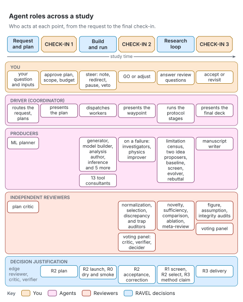
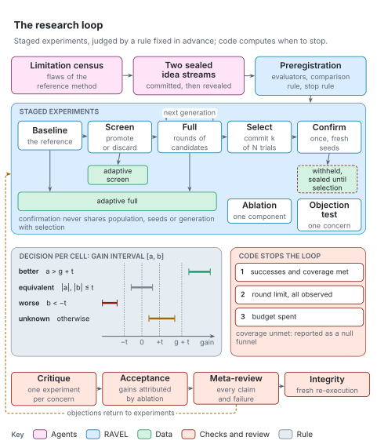
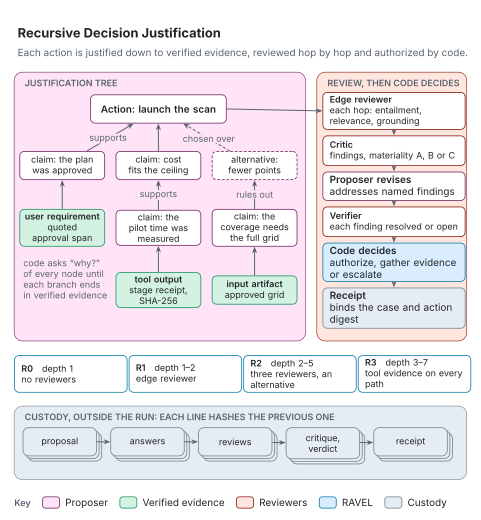
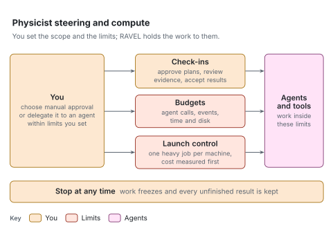
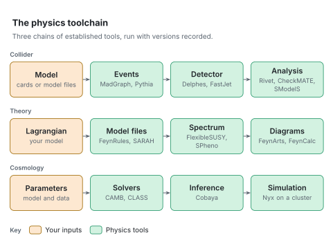
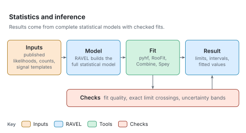
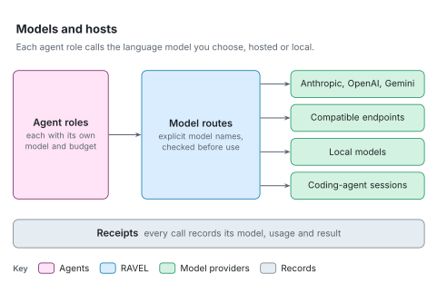
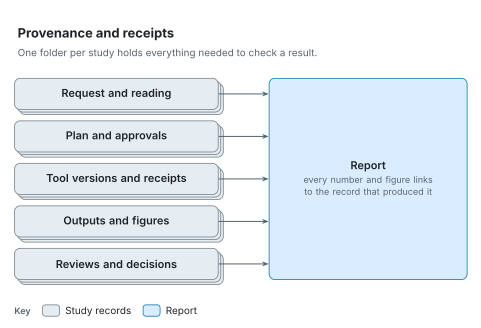
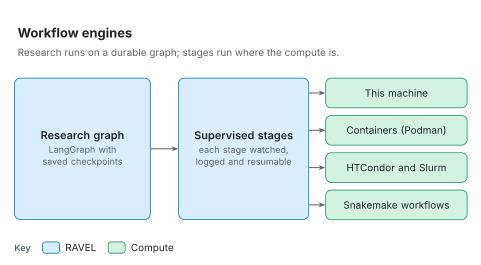

# RAVEL

RAVEL is an agent-driven research system for high-energy physics. You state a physics question in plain words; AI agents plan the study, run established physics tools and review the evidence, and you approve each major step. Every delivered number links to the inputs, tool versions and decisions that produced it.

[Install](#install) · [A first study](#a-first-study) · [How it works](#how-it-works) · [What RAVEL covers](#what-ravel-covers) · [Toolchain](#toolchain) · [Documentation](#documentation) · [Citing RAVEL](#citing-ravel)

<a id="1-check-the-installation"></a>

## Install

```bash
git clone https://github.com/ammarphp/ravel.git
cd ravel
bash scripts/setup/install.sh
.venv/bin/ravel doctor
```

The installer brings its own Python, needs no administrator rights and resumes a failed step where it stopped.
<!-- ravel:disk:start -->
The default installation needs 63.1 GB of disk space.
<!-- ravel:disk:end -->
It plans about 8 hours for the default toolchain; `bash scripts/setup/install.sh --dry-run` prints the size and time of each part before anything changes.

The symbolic tools use your Wolfram Engine or Mathematica licence. The [installation guide](docs/installation.md) covers the licence, analysis-facility installs and model-provider setup.

<a id="start-a-study"></a>
<a id="quick-start"></a>
<a id="2-compute-a-first-limit"></a>
<a id="3-ask-a-coding-agent"></a>
<a id="working-with-a-coding-agent"></a>
<a id="commands"></a>

## A first study

Open the checkout in your coding agent and ask, for example: *"Reinterpret a published search through its released likelihood for the model in `cards/`, and give the 95% CLs limit on the signal strength."*
<!-- ravel:example-mode:generate -->
<!-- ravel:example-mode:event-production -->
<!-- ravel:example-mode:analyze -->
<!-- ravel:example-mode:signal-template -->
<!-- ravel:example-mode:likelihood -->

The agent drives the commands below; you can also run them yourself with your own [study specification](docs/workflow/reference/scoped-workflows.md).

```bash
source .venv/bin/activate
ravel initiate --prompt "Your physics question" --out studies/my-question
ravel status --rundir studies/my-question --write
ravel plan --rundir studies/my-question --spec study.json
ravel approve --rundir studies/my-question --quote "Approved as planned."
ravel run --rundir studies/my-question
```

1. **Plan.** The agent reads the request into facts, goals and open questions. It finds the paper, its likelihood and the analysis code, then writes a plan with numbered assumptions and a compute budget. `ravel status` shows the next step at any point.
2. **CHECK-IN 1.** You approve the plan in your own words, change it or ask questions. No events are generated before this approval.
3. **Work.** Agents and supervised tool stages generate and shower the signal events, run the analysis routine and build the signal templates.
4. **CHECK-IN 2.** Reviewers judge the first evidence, such as the selected signal yields, and the study continues on GO or is revised on ADJUST. A plan built from a specification skips this step.
5. **CHECK-IN 3.** A fresh review panel checks every result against the original question.

You receive the limit with its fit diagnostics, publication-style figures and a report, and the run directory that records how each number was made.

<a id="how-ravel-works"></a>
<a id="how-a-calculation-runs"></a>

## How it works

Agents propose and do the work, code checks every gate, and you approve. The [methodology pages](docs/methodology/README.md) give the details.

### Studies and check-ins

A **study** is one question carried from request to delivered result. It lives in a **run directory** that holds the request, the plan, approvals, inputs, outputs and working records; the custody ledgers that authenticate them are kept outside it. The plan is a sequence of **operations**: typed units of scientific work with declared inputs, outputs, tools and review checks. Each operation runs under a science **mode** that binds it to its code and to the tools it needs. Tool runs are **stages**. A **supervisor** runs each stage within its wall-time limit and records any failure. Each stage leaves a **receipt**: a record, written by code, of what ran, on which inputs and with which versions.

A plan the driver agent writes stops at three check-ins. **CHECK-IN 1** approves the plan, its assumptions and its budget; its **approval scope** names the largest compute plan allowed: none (no compute), dry (cards, no events), smoke (one small point), full (one full point, or a specification plan's whole calculation) or scan (every point). **CHECK-IN 2** is the early verification: reviewers judge the first evidence and the answer is GO or ADJUST. **CHECK-IN 3** reviews the final results and the whole task before delivery. A plan built from a specification has no CHECK-IN 2; its result review shapes the next proposal. A change of plan between check-ins is a **deviation**, reported at once and recorded. You decide each check-in yourself, or delegate plan approval, the CHECK-IN 2 GO and acceptance of a recommendation to an agent within the stages, file paths, compute plans and number of redos you declare.

<picture>
  <source media="(prefers-color-scheme: dark)" srcset="docs/figures/svg/dark/readme-overview.svg">
  
</picture>

### Agents and roles

Each agent **role** has a card that fixes its task, tools and limits.

- The **driver agent** is the coding-agent session you talk to. It holds the coordinator role: it reads the request, writes the plan, dispatches work and presents each check-in. It never reviews its own work.
- The **plan critic** reviews the plan at CHECK-IN 1. Its review advises you, and binds an agent that approves on your behalf.
- **Workers** do the scientific work: event generation, analysis code, models, fits and calculations, with a consultant for each major tool. Each worker runs in a fresh session and workspace with a budget of turns, wall time, calls and cost, sandboxed on command-line routes.
- **Reviewers** decide. At CHECK-IN 2 each claim passes a physics critic, a skeptical verifier and a physics decider, joined by specialists when the claim needs them. A figure critic and an integrity auditor check deliverables, and CHECK-IN 3 uses a fresh panel. A root-cause investigator takes each failed stage.
- **Research roles** run the research loop below.

Independence comes from the **transport**, the route a role's call takes: a hosted model API, a command-line agent session, a sandboxed worker or a sub-agent of the host. A voting reviewer runs in a fresh session, separate from the driver; on an agent-session route it runs as a sandboxed worker. Its route must meet the role's requirements and **qualification**: a recorded probe of the route or a live conformance run. Each call leaves a session receipt stating how the separation was attested. See [agent architecture](docs/methodology/agent-architecture.md).

<picture>
  <source media="(prefers-color-scheme: dark)" srcset="docs/figures/svg/dark/methodology-agent-roles.svg">
  
</picture>

### The research loop

Open-ended questions and method studies run through the **research loop**: a staged protocol that turns hypotheses into experiments and decides each experiment by a rule fixed before the data are seen.

Two independent idea streams, one citation-led and one speculative, post hypotheses to the **hypothesis board**. Posting is sealed: every participant commits a digest of its hypothesis before any is revealed. Each hypothesis states categorical predictions and a kill condition, and code moves it between states such as *survived test*, *prediction mismatch* and *rejected in scope* from retained evidence. Each experiment's purpose fixes the data it reads and what must precede it:

1. **Baseline.** The reference method, reproduced.
2. **Screen.** Each idea is promoted or discarded on inexpensive evaluation cells.
3. **Full run.** Full-fidelity cells; the selection of up to eight candidates is committed as a hashed record.
4. **Withheld confirmation.** Data disjoint from every selection input, read after the selection is committed; each withheld population is read once.
5. **Ablations and objection tests.** An **ablation** changes exactly one component of a candidate; each reviewer objection becomes a discriminating experiment.

Each comparison with the baseline gives a gain interval per cell. Code maps it to **better**, **equivalent**, **worse** or **unknown** against a declared minimum gain and tolerance. A stopping rule registered in advance ends the rounds at a success target, a round limit or a budget; continuing past it is a recorded decision. Critique, acceptance, meta-review and an integrity audit complete the protocol. See [the research loop](docs/methodology/research-loop.md).

<picture>
  <source media="(prefers-color-scheme: dark)" srcset="docs/figures/svg/dark/methodology-research-loop.svg">
  
</picture>

### Recursive Decision Justification

**Recursive Decision Justification** (RDJ) decides whether an agent's proposed step proceeds. It runs at each consequential gate: plan approval, launch of compute, acceptance at CHECK-IN 2, research choices, delivery and export.

1. The proposing agent commits the action, and code asks why it should be taken.
2. Each answer is a claim. Code asks why each open claim should be believed, recursively, until every branch ends in an **anchor** that RAVEL verifies itself: a tool output with a stage receipt, a measurement, an input file, your recorded words or a shipped invariant. Agent-written text and review verdicts can be cited but never close a branch.
3. An edge reviewer judges each link, a critic files findings, the proposer revises and a verifier rules on each finding. Reviewers never review their own work; at R3 the critic and verifier are separate sessions.
4. Code, not a model, then authorizes the step, requests more evidence or escalates to you, and writes a receipt.

A risk class from R0 to R3 sets the required depth (up to seven levels), the revision rounds and the independence. Plan approval and launch start at R2, delivery and export at R3; dry and smoke launches drop lower, large or costly steps rise, and irreversible steps also need your approval. Each step is appended to **custody**: hash-chained ledgers kept outside the run directory and replayed on every load, so an edited case is refused. See [Recursive Decision Justification](docs/methodology/decision-justification.md).

<picture>
  <source media="(prefers-color-scheme: dark)" srcset="docs/figures/svg/dark/methodology-decision-justification.svg">
  
</picture>

<a id="what-ravel-does"></a>
<a id="supported-analyses-and-statistics"></a>

## What RAVEL covers

Each family groups the operations of this release. A study combines them; when an analysis routine or model is missing, worker agents write it and reviewers check it.

<!-- ravel:capabilities:start -->
| Family | Operations | Examples |
|---|--:|---|
| [Event generation and simulation](docs/reference/event-production.md) | 17 | MadGraph generation with decays and named weights, Pythia showering, Delphes detector simulation, LHE rewrites, PDF variations |
| [Analysis and reinterpretation](docs/workflow/reference/scientific-studies.md) | 25 | Rivet, SimpleAnalysis and MadAnalysis 5 routines, columnar selections, newly written analysis code, SModelS and Contur constraints, signal patches for published likelihoods |
| [Statistics and limits](docs/reference/inference-engines.md) | 24 | 95% CLs limits with pyhf, statistics the request prescribes, CMS Combine and RooFit likelihoods, profile fits, workspace combinations |
| [Measurements and global fits](docs/reference/quantities-and-measurements.md) | 12 | Higgs coupling and signal-strength fits, SFitter global fits, EFT responses and coefficient conventions, EasyScan parameter scans |
| [Models and calculations](docs/reference/models-and-normalization.md) | 26 | FeynRules and SARAH models, FlexibleSUSY and SPheno spectra, widths and decays, Feynman diagrams and amplitudes, loop integrals, EFT running, symbolic and numerical calculations |
| [Machine learning](docs/workflow/checklists/ml-training.md) | 3 | Classifier training against baselines with one held-out test, published ONNX classifiers on supplied events |
| [Literature, comparison and reports](docs/workflow/reference/research-orchestration.md) | 7 | Literature census and published-limit overlays, figure digitisation and comparison, result comparisons, report delivery |
<!-- ravel:capabilities:end -->

<a id="toolchain-and-platforms"></a>

## Toolchain

The installer sets up the tools below and `ravel doctor` checks them. You install the Wolfram kernel yourself. On a Mac, SimpleAnalysis and CMS Combine run in installer-built containers; the facility environments and Nyx run on a Linux site. Each study records the exact versions it used.

<!-- ravel:toolchain:start -->
| Toolchain | Tools |
|---|---|
| Miniforge and the build compilers | Miniforge |
| RAVEL's Python environments (.venv, .venv-smodels, .venv-sfitter) |  |
| Model-provider configuration for research and review roles |  |
| MadGraph5_aMC@NLO 2.9.27 and 3.7.0 with LHAPDF 6.5.6 | MadGraph5_aMC@NLO, LHAPDF |
| LHAPDF parton-density sets in one shared data directory | LHAPDF PDF sets |
| Rivet 4.1.3, Pythia 8.312, HepMC3 and RAVEL's shower programs | Rivet and YODA, Pythia 8, HepMC3 |
| MadGraph-Pythia 8 interface for MadGraph's own showering | MG5aMC_PY8_interface |
| ROOT 6.40, FastJet 3.5.2 and Delphes 3.5.1 | ROOT, FastJet, Delphes |
| MadAnalysis 5 v1.11.1 with SampleAnalyzer | MadAnalysis 5 |
| CheckMATE 2 with its own Pythia 8.244 and Delphes 3.5.1 | CheckMATE, Delphes, Pythia 8 |
| Container engine for the Linux-only tools | Podman, vfkit and gvproxy |
| ATLAS SimpleAnalysis (container) and mapyde 0.5.0 | mapyde |
| RestFrames library and RAVEL's recursive-jigsaw program | RestFrames |
| Analysis source catalogue | Rivet |
| CMS Combine 9.2.1 on ROOT 6.22 (container) | ROOT, CMS Combine |
| Wolfram kernel (your licence) with FeynRules, SARAH, FeynCalc, FeynArts and HEPTAPOD | FeynRules, SARAH, FeynCalc, FeynArts, HEPTAPOD |
| FlexibleSUSY 2.9.0 (CMSSM, lowMSSM, NMSSM) and SPheno 4.0.5 | FlexibleSUSY, SPheno |
| pySecDec 1.6.6 with FORM | pySecDec and FORM |
| SModelS 3.2.1 database (3.1.1 kept runnable) | SModelS database 3.2.1, SModelS database 3.1.1 |
| Contur 3.1.5 with its data and Herwig 7.3.0 | Contur, Herwig and ThePEG |
| CAMB, CLASS and Cobaya (in the main Python environment) | CAMB, CLASS (classy), Cobaya |
| SFitterAgents source in .venv-sfitter | SFitterAgents |
| EasyScan_HEP with GM2Calc 2.3.1 and PhaseTracer | EasyScan_HEP, GM2Calc, PhaseTracer, ALGLIB |
| ServiceX client | ServiceX, func-adl-servicex-xaodr25 |
| Nyx 26.09 with AMReX 26.09 and SUNDIALS 7.6.0 | Nyx and AMReX, SUNDIALS |
| PDF, graph and SVG tools for reports | poppler, Graphviz, librsvg, pypdfium2, pypdf |
| Linux site analysis and Snakemake environments |  |
| Analysis-facility access: CVMFS, grid proxy, Kerberos, HTCondor, apptainer, agent CLI |  |
| MCFM per-point helicity amplitudes for interfering resonances | MCFM |
| FeynGraph diagram generator (Rust build) | FeynGraph |
| HEPTAPOD NDA and Diagrammatica EDA diagram tools | HEPTAPOD |
| External agent sources (AgentRivet) | AgentRivet |
| Machine-learning libraries: scikit-learn, PyTorch (CPU) and PyTorch Geometric | scikit-learn, PyTorch (CPU), PyTorch Geometric |
| PDG 2026 offline database (data CC BY 4.0) and RAVEL's pinned subset | PDG Review of Particle Physics data (2026 edition), pdg Python package |
| TeX manuscript compiler and class assets |  |
<!-- ravel:toolchain:end -->

<a id="outputs"></a>
<a id="what-ravel-checks"></a>
<a id="limitations"></a>
<a id="getting-help-and-contributing"></a>

## Documentation

- [Installation guide](docs/installation.md): profiles, facilities, Wolfram and model providers
- [Workflow start](docs/workflow/start.md): how a question becomes a study
- [Agent architecture](docs/methodology/agent-architecture.md), [research loop](docs/methodology/research-loop.md) and [Recursive Decision Justification](docs/methodology/decision-justification.md): the methods in full
- [Scientific studies](docs/workflow/reference/scientific-studies.md): studies on your own events, models and likelihoods
- [Command reference](docs/cli.md): every `ravel` command
- [Architecture pages](docs/architecture/README.md): each stage in detail
- [Glossary](docs/reference/glossary.md): every term used here
- [Contributing](CONTRIBUTING.md) and [issues](https://github.com/ammarphp/ravel/issues)

<a id="licence-and-citation"></a>

## Citing RAVEL

Cite RAVEL with [CITATION.cff](CITATION.cff) or GitHub's "Cite this repository" button. Please also cite the upstream tools your study used ([Appendix B](#appendix-b-citing-upstream-tools)); each study lists them in its report.

<a id="license"></a>

## Licence

RAVEL is released under the [Apache License 2.0](LICENSE). Each upstream tool keeps its own licence; see [NOTICE](NOTICE) and [THIRD-PARTY-NOTICES.md](THIRD-PARTY-NOTICES.md).

## Appendix A: Architecture

Six more parts complete the architecture. Every figure uses one colour code: amber for you, pink for agents, red for review and limits, blue for RAVEL, green for external tools and services, and grey for records.

<details>
<summary><b>Physicist steering and compute</b></summary>

You decide what runs. Budgets cap agent calls, generated events, wall time and disk. Launch control runs one heavy scientific job per machine and measures the cost of new event generation with small pilot runs first. A stop request freezes the work and keeps every unfinished result.

**In:** your approvals, budgets and instructions. **Out:** work inside the scope and limits you set, with each decision recorded.

<picture>
  <source media="(prefers-color-scheme: dark)" srcset="docs/figures/svg/dark/arch-steering.svg">
  
</picture>

</details>

<details>
<summary><b>The physics toolchain</b></summary>

Three chains of established tools cover the physics. The collider chain runs from a model to generated events, detector simulation and analysis. The theory chain runs from a Lagrangian to model files, spectra and decays, and diagrams and amplitudes. The cosmology chain runs from parameters and data to solvers, inference and simulation.

**In:** models, cards, event files and data. **Out:** events, histograms, spectra, amplitudes and power spectra with recorded settings.

<picture>
  <source media="(prefers-color-scheme: dark)" srcset="docs/figures/svg/dark/arch-toolchain.svg">
  
</picture>

</details>

<details>
<summary><b>Statistics and inference</b></summary>

RAVEL builds the complete statistical model from published likelihoods, event counts, backgrounds and signal templates, and fits it with established engines. Every fit passes numerical checks of fit quality, exact limit crossings and uncertainty bands. Exclusion results are 95% CLs limits unless you prescribe another statistic.

**In:** likelihoods, counts and signal templates. **Out:** limits, intervals and fitted values with their diagnostics.

<picture>
  <source media="(prefers-color-scheme: dark)" srcset="docs/figures/svg/dark/arch-statistics.svg">
  
</picture>

</details>

<details>
<summary><b>Models and hosts</b></summary>

Each agent role calls a language model you choose: the Anthropic, OpenAI or Gemini APIs, any compatible endpoint such as vLLM, Ollama or llama.cpp, local models, or coding-agent sessions. Each route names its exact models and is checked before use, and each call records its model, usage and result.

**In:** your provider configuration and each role's model and budget. **Out:** agent answers with a receipt for every call.

<picture>
  <source media="(prefers-color-scheme: dark)" srcset="docs/figures/svg/dark/arch-models-hosts.svg">
  
</picture>

</details>

<details>
<summary><b>Provenance and receipts</b></summary>

Each study lives in one folder: the request and its reading, the plan and approvals, tool versions and run receipts, outputs and figures, and the reviews and decisions. The report links every number and figure to the record that produced it, so anyone can check a result or rerun the study.

**In:** everything a study reads, runs and decides. **Out:** a self-contained study folder and a linked report.

<picture>
  <source media="(prefers-color-scheme: dark)" srcset="docs/figures/svg/dark/arch-provenance.svg">
  
</picture>

</details>

<details>
<summary><b>Workflow engines</b></summary>

Agent work runs on a LangGraph graph with saved checkpoints, so long investigations resume where they stopped. Each tool run is a supervised stage that is watched, logged and resumable. Stages run on this machine, in containers, on HTCondor and Slurm batch systems, or as Snakemake workflows at an analysis facility.

**In:** approved stages and their resource limits. **Out:** completed stages with logs and receipts.

<picture>
  <source media="(prefers-color-scheme: dark)" srcset="docs/figures/svg/dark/arch-engines.svg">
  
</picture>

</details>

<a id="appendix-b-citing-upstream-dependencies"></a>

## Appendix B: Citing upstream tools

When you publish results from a study, cite the tools it used. Each entry gives the reference the tool asks for; where a tool names none, the entry gives its release paper or its home page. [upstream.json](src/ravel/data/citations/upstream.json) records where each reference was found, and `scripts/maintenance/render_citations.py` renders this list from it. [THIRD-PARTY-NOTICES.md](THIRD-PARTY-NOTICES.md) lists the upstream code RAVEL redistributes and its licences.

<details>
<summary>References for each upstream tool</summary>

**[MadGraph5_aMC@NLO](https://github.com/mg5amcnlo/mg5amcnlo)**: event generation.

1. J. Alwall et al., “The automated computation of tree-level and next-to-leading order differential cross sections, and their matching to parton shower simulations”, *JHEP* **07** (2014) 079, [arXiv:1405.0301](https://arxiv.org/abs/1405.0301), [doi:10.1007/JHEP07(2014)079](https://doi.org/10.1007/JHEP07%282014%29079).
2. For mixed-coupling or NLO electroweak computations, also: R. Frederix et al., “The automation of next-to-leading order electroweak calculations”, *JHEP* **11** (2021) 085, [arXiv:1804.10017](https://arxiv.org/abs/1804.10017), [doi:10.1007/JHEP11(2021)085](https://doi.org/10.1007/JHEP11%282021%29085).

**[Pythia 8](https://pythia.org/)**: showering and hadronisation.

3. C. Bierlich et al., “A comprehensive guide to the physics and usage of PYTHIA 8.3”, *SciPost Phys. Codeb.* **8** (2022), [arXiv:2203.11601](https://arxiv.org/abs/2203.11601), [doi:10.21468/SciPostPhysCodeb.8](https://doi.org/10.21468/SciPostPhysCodeb.8).

**[Herwig 7](https://herwig.hepforge.org/)**: event generation and showering.

4. J. Bellm et al., “Herwig 7.0/Herwig++ 3.0 release note”, *Eur. Phys. J. C* **76** (2016) 196, [arXiv:1512.01178](https://arxiv.org/abs/1512.01178), [doi:10.1140/epjc/s10052-016-4018-8](https://doi.org/10.1140/epjc/s10052-016-4018-8).

**[HepMC3](https://gitlab.cern.ch/hepmc/HepMC3)**: event records.

5. A. Buckley et al., “The HepMC3 event record library for Monte Carlo event generators”, *Comput. Phys. Commun.* **260** (2021) 107310, [arXiv:1912.08005](https://arxiv.org/abs/1912.08005), [doi:10.1016/j.cpc.2020.107310](https://doi.org/10.1016/j.cpc.2020.107310).

**[Delphes](https://github.com/delphes/delphes)**: detector simulation.

6. J. de Favereau et al. (DELPHES 3 Collaboration), “DELPHES 3, A modular framework for fast simulation of a generic collider experiment”, *JHEP* **02** (2014) 057, [arXiv:1307.6346](https://arxiv.org/abs/1307.6346), [doi:10.1007/JHEP02(2014)057](https://doi.org/10.1007/JHEP02%282014%29057).

**[FastJet](https://fastjet.fr/)**: jet clustering.

7. M. Cacciari, G. P. Salam and G. Soyez, “FastJet User Manual”, *Eur. Phys. J. C* **72** (2012) 1896, [arXiv:1111.6097](https://arxiv.org/abs/1111.6097), [doi:10.1140/epjc/s10052-012-1896-2](https://doi.org/10.1140/epjc/s10052-012-1896-2).
8. Optionally, also: M. Cacciari and G. P. Salam, “Dispelling the $N^3$ myth for the $k_t$ jet-finder”, *Phys. Lett. B* **641** (2006) 57, [arXiv:hep-ph/0512210](https://arxiv.org/abs/hep-ph/0512210), [doi:10.1016/j.physletb.2006.08.037](https://doi.org/10.1016/j.physletb.2006.08.037).

**[LHAPDF](https://lhapdf.hepforge.org/)**: parton densities.

9. A. Buckley et al., “LHAPDF6: parton density access in the LHC precision era”, *Eur. Phys. J. C* **75** (2015) 132, [arXiv:1412.7420](https://arxiv.org/abs/1412.7420), [doi:10.1140/epjc/s10052-015-3318-8](https://doi.org/10.1140/epjc/s10052-015-3318-8).

**[MCFM](https://mcfm.fnal.gov/)**: amplitudes for interfering resonances. Home page: <https://mcfm.fnal.gov/>.

**[Rivet](https://gitlab.com/hepcedar/rivet)**: analysis routines.

10. C. Bierlich et al., “Robust independent validation of experiment and theory: Rivet version 4 release note”, *SciPost Phys. Codeb.* **36** (2024), [arXiv:2404.15984](https://arxiv.org/abs/2404.15984), [doi:10.21468/SciPostPhysCodeb.36](https://doi.org/10.21468/SciPostPhysCodeb.36).

**[YODA](https://gitlab.com/hepcedar/yoda)**: histograms.

11. A. Buckley et al., “Consistent, multidimensional differential histogramming and summary statistics with YODA 2”, *SciPost Phys. Codeb.* **45** (2025), [arXiv:2312.15070](https://arxiv.org/abs/2312.15070), [doi:10.21468/SciPostPhysCodeb.45](https://doi.org/10.21468/SciPostPhysCodeb.45).

**[ATLAS SimpleAnalysis](https://gitlab.cern.ch/atlas-sa/simple-analysis)**: public ATLAS selections. Home page: <https://gitlab.cern.ch/atlas-sa/simple-analysis>.

**[RestFrames](https://github.com/crogan/RestFrames)**: recursive-jigsaw reconstruction. Home page: <http://restframes.com/>.

**[MAPyDE](https://github.com/scipp-atlas/mapyde)**: card conventions and event conversion.

12. M. Hance and G. Stark, “mapyde”, Zenodo, [doi:10.5281/zenodo.7796373](https://doi.org/10.5281/zenodo.7796373).
13. G. Stark, C. A. Ots and M. Hance, “Reduce, Reuse, Reinterpret: an end-to-end pipeline for recycling particle physics results”, *SciPost Phys. Codeb.* **27** (2024), [arXiv:2306.11055](https://arxiv.org/abs/2306.11055), [doi:10.21468/SciPostPhysCodeb.27](https://doi.org/10.21468/SciPostPhysCodeb.27).

**[CheckMATE](https://github.com/CheckMATE2/checkmate2)**: reinterpretation.

14. I. Lara and K. Rolbiecki, “Implementation of full and simplified likelihoods in CheckMATE”, *Eur. Phys. J. C* **86** (2026) 221, [arXiv:2507.08565](https://arxiv.org/abs/2507.08565), [doi:10.1140/epjc/s10052-026-15414-8](https://doi.org/10.1140/epjc/s10052-026-15414-8).
15. D. Dercks et al., “CheckMATE 2: From the model to the limit”, *Comput. Phys. Commun.* **221** (2017) 383, [arXiv:1611.09856](https://arxiv.org/abs/1611.09856), [doi:10.1016/j.cpc.2017.08.021](https://doi.org/10.1016/j.cpc.2017.08.021).

**[MadAnalysis 5](https://github.com/MadAnalysis/madanalysis5)**: reinterpretation.

16. E. Conte, B. Fuks and G. Serret, “MadAnalysis 5, A User-Friendly Framework for Collider Phenomenology”, *Comput. Phys. Commun.* **184** (2013) 222, [arXiv:1206.1599](https://arxiv.org/abs/1206.1599), [doi:10.1016/j.cpc.2012.09.009](https://doi.org/10.1016/j.cpc.2012.09.009).
17. E. Conte et al., “Designing and recasting LHC analyses with MadAnalysis 5”, *Eur. Phys. J. C* **74** (2014) 3103, [arXiv:1405.3982](https://arxiv.org/abs/1405.3982), [doi:10.1140/epjc/s10052-014-3103-0](https://doi.org/10.1140/epjc/s10052-014-3103-0).
18. B. Dumont et al., “Toward a public analysis database for LHC new physics searches using MADANALYSIS 5”, *Eur. Phys. J. C* **75** (2015) 56, [arXiv:1407.3278](https://arxiv.org/abs/1407.3278), [doi:10.1140/epjc/s10052-014-3242-3](https://doi.org/10.1140/epjc/s10052-014-3242-3).
19. E. Conte and B. Fuks, “Confronting new physics theories to LHC data with MADANALYSIS 5”, *Int. J. Mod. Phys. A* **33** (2018) 1830027, [arXiv:1808.00480](https://arxiv.org/abs/1808.00480), [doi:10.1142/S0217751X18300272](https://doi.org/10.1142/S0217751X18300272).
20. J. Y. Araz, M. Frank and B. Fuks, “Reinterpreting the results of the LHC with MadAnalysis 5: uncertainties and higher-luminosity estimates”, *Eur. Phys. J. C* **80** (2020) 531, [arXiv:1910.11418](https://arxiv.org/abs/1910.11418), [doi:10.1140/epjc/s10052-020-8076-6](https://doi.org/10.1140/epjc/s10052-020-8076-6).
21. J. Y. Araz, B. Fuks and G. Polykratis, “Simplified fast detector simulation in MADANALYSIS 5”, *Eur. Phys. J. C* **81** (2021) 329, [arXiv:2006.09387](https://arxiv.org/abs/2006.09387), [doi:10.1140/epjc/s10052-021-09052-5](https://doi.org/10.1140/epjc/s10052-021-09052-5).
22. J. Y. Araz et al., “Recasting LHC searches for long-lived particles with MadAnalysis 5”, *Eur. Phys. J. C* **82** (2022) 597, [arXiv:2112.05163](https://arxiv.org/abs/2112.05163), [doi:10.1140/epjc/s10052-022-10511-w](https://doi.org/10.1140/epjc/s10052-022-10511-w).
23. G. Alguero et al., “Signal region combination with full and simplified likelihoods in MadAnalysis 5”, *SciPost Phys.* **14** (2023) 009, [arXiv:2206.14870](https://arxiv.org/abs/2206.14870), [doi:10.21468/SciPostPhys.14.1.009](https://doi.org/10.21468/SciPostPhys.14.1.009).
24. J. Y. Araz, A. Buckley and B. Fuks, “Searches for new physics with boosted top quarks in the MadAnalysis 5 and Rivet frameworks”, *Eur. Phys. J. C* **83** (2023) 664, [arXiv:2303.03427](https://arxiv.org/abs/2303.03427), [doi:10.1140/epjc/s10052-023-11779-2](https://doi.org/10.1140/epjc/s10052-023-11779-2).

**[SModelS](https://github.com/SModelS/smodels)**: simplified-model constraints.

25. M. M. Altakach et al., “SModelS v3: going beyond $\mathcal{Z}_2$ topologies”, *JHEP* **11** (2024) 074, [arXiv:2409.12942](https://arxiv.org/abs/2409.12942), [doi:10.1007/JHEP11(2024)074](https://doi.org/10.1007/JHEP11%282024%29074).
26. M. M. Altakach et al., “SModelS v2.3: Enabling global likelihood analyses”, *SciPost Phys.* **15** (2023) 185, [arXiv:2306.17676](https://arxiv.org/abs/2306.17676), [doi:10.21468/SciPostPhys.15.5.185](https://doi.org/10.21468/SciPostPhys.15.5.185).
27. G. Alguero et al., “Constraining new physics with SModelS version 2”, *JHEP* **08** (2022) 068, [arXiv:2112.00769](https://arxiv.org/abs/2112.00769), [doi:10.1007/JHEP08(2022)068](https://doi.org/10.1007/JHEP08%282022%29068).
28. G. Alguero, S. Kraml and W. Waltenberger, “A SModelS interface for pyhf likelihoods”, *Comput. Phys. Commun.* **264** (2021) 107909, [arXiv:2009.01809](https://arxiv.org/abs/2009.01809), [doi:10.1016/j.cpc.2021.107909](https://doi.org/10.1016/j.cpc.2021.107909).
29. F. Ambrogi et al., “SModelS v1.2: long-lived particles, combination of signal regions, and other novelties”, *Comput. Phys. Commun.* **251** (2020) 106848, [arXiv:1811.10624](https://arxiv.org/abs/1811.10624), [doi:10.1016/j.cpc.2019.07.013](https://doi.org/10.1016/j.cpc.2019.07.013).
30. F. Ambrogi et al., “SModelS v1.1 user manual: Improving simplified model constraints with efficiency maps”, *Comput. Phys. Commun.* **227** (2018) 72, [arXiv:1701.06586](https://arxiv.org/abs/1701.06586), [doi:10.1016/j.cpc.2018.02.007](https://doi.org/10.1016/j.cpc.2018.02.007).
31. S. Kraml et al., “SModelS: a tool for interpreting simplified-model results from the LHC and its application to supersymmetry”, *Eur. Phys. J. C* **74** (2014) 2868, [arXiv:1312.4175](https://arxiv.org/abs/1312.4175), [doi:10.1140/epjc/s10052-014-2868-5](https://doi.org/10.1140/epjc/s10052-014-2868-5).

**[Contur](https://gitlab.com/hepcedar/contur)**: constraints from measurements.

32. J. M. Butterworth et al., “Constraining new physics with collider measurements of Standard Model signatures”, *JHEP* **03** (2017) 078, [arXiv:1606.05296](https://arxiv.org/abs/1606.05296), [doi:10.1007/JHEP03(2017)078](https://doi.org/10.1007/JHEP03%282017%29078).
33. A. Buckley et al. (Contur Collaboration), “Testing new physics models with global comparisons to collider measurements: the Contur toolkit”, *SciPost Phys. Core* **4** (2021) 013, [arXiv:2102.04377](https://arxiv.org/abs/2102.04377), [doi:10.21468/SciPostPhysCore.4.2.013](https://doi.org/10.21468/SciPostPhysCore.4.2.013).

**[AgentRivet](https://gitlab.com/hepcedar/AgentRivet)**: agent-built Rivet routines. Home page: <https://gitlab.com/hepcedar/AgentRivet>.

**[HEPData](https://www.hepdata.net/)**: published data tables. Home page: <https://www.hepdata.net/>.

**[pyhf](https://github.com/scikit-hep/pyhf)**: likelihood fits.

34. L. Heinrich, M. Feickert and G. Stark, “pyhf”, Zenodo, [doi:10.5281/zenodo.1169739](https://doi.org/10.5281/zenodo.1169739).
35. L. Heinrich et al., “pyhf: pure-Python implementation of HistFactory statistical models”, *J. Open Source Softw.* **6** (2021) 2823, [doi:10.21105/joss.02823](https://doi.org/10.21105/joss.02823).

**[ROOT](https://root.cern/)**: data handling and RooFit.

36. R. Brun and F. Rademakers, “ROOT — An object oriented data analysis framework”, *Nucl. Instrum. Meth. A* **389** (1997) 81, [doi:10.1016/S0168-9002(97)00048-X](https://doi.org/10.1016/S0168-9002%2897%2900048-X).

**[CMS Combine](https://github.com/cms-analysis/HiggsAnalysis-CombinedLimit)**: statistical combinations.

37. CMS Collaboration, “The CMS Statistical Analysis and Combination Tool: Combine”, *Comput. Softw. Big Sci.* **8** (2024) 19, [arXiv:2404.06614](https://arxiv.org/abs/2404.06614), [doi:10.1007/s41781-024-00121-4](https://doi.org/10.1007/s41781-024-00121-4).

**[Spey](https://github.com/SpeysideHEP/spey)**: measurement likelihoods.

38. J. Y. Araz, “Spey: Smooth inference for reinterpretation studies”, *SciPost Phys.* **16** (2024) 032, [arXiv:2307.06996](https://arxiv.org/abs/2307.06996), [doi:10.21468/SciPostPhys.16.1.032](https://doi.org/10.21468/SciPostPhys.16.1.032).

**[iminuit](https://github.com/scikit-hep/iminuit)**: minimisation.

39. H. Dembinski et al., “iminuit”, Zenodo, [doi:10.5281/zenodo.7695764](https://doi.org/10.5281/zenodo.7695764).
40. F. James and M. Roos, “Minuit: A System for Function Minimization and Analysis of the Parameter Errors and Correlations”, *Comput. Phys. Commun.* **10** (1975) 343, [doi:10.1016/0010-4655(75)90039-9](https://doi.org/10.1016/0010-4655%2875%2990039-9).

**[Wolfram Engine](https://www.wolfram.com/engine/)**: symbolic kernel. Home page: <https://www.wolfram.com/engine/>.

**[FeynRules](https://feynrules.irmp.ucl.ac.be/)**: model files from a Lagrangian.

41. A. Alloul et al., “FeynRules 2.0 - A complete toolbox for tree-level phenomenology”, *Comput. Phys. Commun.* **185** (2014) 2250, [arXiv:1310.1921](https://arxiv.org/abs/1310.1921), [doi:10.1016/j.cpc.2014.04.012](https://doi.org/10.1016/j.cpc.2014.04.012).

**[SARAH](https://sarah.hepforge.org/)**: model files and spectrum generators.

42. F. Staub, “SARAH 4: A tool for (not only SUSY) model builders”, *Comput. Phys. Commun.* **185** (2014) 1773, [arXiv:1309.7223](https://arxiv.org/abs/1309.7223), [doi:10.1016/j.cpc.2014.02.018](https://doi.org/10.1016/j.cpc.2014.02.018).

**[FeynArts](https://feynarts.de/)**: diagram generation.

43. T. Hahn, “Generating Feynman diagrams and amplitudes with FeynArts 3”, *Comput. Phys. Commun.* **140** (2001) 418, [arXiv:hep-ph/0012260](https://arxiv.org/abs/hep-ph/0012260), [doi:10.1016/S0010-4655(01)00290-9](https://doi.org/10.1016/S0010-4655%2801%2900290-9).

**[FeynCalc](https://github.com/FeynCalc/feyncalc)**: amplitude algebra.

44. V. Shtabovenko, “FeynCalc 10.2 and FeynHelpers 2: Multiloop calculations streamlined” (2025), [arXiv:2512.19858](https://arxiv.org/abs/2512.19858).
45. V. Shtabovenko, R. Mertig and F. Orellana, “FeynCalc 10: Do multiloop integrals dream of computer codes?”, *Comput. Phys. Commun.* **306** (2025) 109357, [arXiv:2312.14089](https://arxiv.org/abs/2312.14089), [doi:10.1016/j.cpc.2024.109357](https://doi.org/10.1016/j.cpc.2024.109357).
46. V. Shtabovenko, R. Mertig and F. Orellana, “FeynCalc 9.3: New features and improvements”, *Comput. Phys. Commun.* **256** (2020) 107478, [arXiv:2001.04407](https://arxiv.org/abs/2001.04407), [doi:10.1016/j.cpc.2020.107478](https://doi.org/10.1016/j.cpc.2020.107478).
47. V. Shtabovenko, R. Mertig and F. Orellana, “New Developments in FeynCalc 9.0”, *Comput. Phys. Commun.* **207** (2016) 432, [arXiv:1601.01167](https://arxiv.org/abs/1601.01167), [doi:10.1016/j.cpc.2016.06.008](https://doi.org/10.1016/j.cpc.2016.06.008).
48. R. Mertig, M. Böhm and A. Denner, “FEYN CALC: Computer algebraic calculation of Feynman amplitudes”, *Comput. Phys. Commun.* **64** (1991) 345, [doi:10.1016/0010-4655(91)90130-D](https://doi.org/10.1016/0010-4655%2891%2990130-D).

**[HEPTAPOD](https://github.com/tonymenzo/heptapod)**: diagram estimates.

49. T. Menzo et al., “HEPTAPOD: Orchestrating High Energy Physics Workflows Towards Autonomous Agency” (2025), [arXiv:2512.15867](https://arxiv.org/abs/2512.15867).

**[Diagrammatica](https://github.com/tonymenzo/heptapod)**: code from diagrams.

50. T. Menzo et al., “Agentic Diagrammatica: Towards Autonomous Symbolic Computation in High Energy Physics” (2026), [arXiv:2603.26990](https://arxiv.org/abs/2603.26990).

**[FeynGraph](https://github.com/jens-braun/feyngraph)**: feynman diagrams. Home page: <https://github.com/jens-braun/feyngraph>.

**[FlexibleSUSY](https://github.com/FlexibleSUSY/FlexibleSUSY)**: spectra and decays.

51. P. Athron et al., “FlexibleSUSY—A spectrum generator generator for supersymmetric models”, *Comput. Phys. Commun.* **190** (2015) 139, [arXiv:1406.2319](https://arxiv.org/abs/1406.2319), [doi:10.1016/j.cpc.2014.12.020](https://doi.org/10.1016/j.cpc.2014.12.020).
52. P. Athron et al., “FlexibleSUSY 2.0: Extensions to investigate the phenomenology of SUSY and non-SUSY models”, *Comput. Phys. Commun.* **230** (2018) 145, [arXiv:1710.03760](https://arxiv.org/abs/1710.03760), [doi:10.1016/j.cpc.2018.04.016](https://doi.org/10.1016/j.cpc.2018.04.016).

**[SPheno](https://spheno.hepforge.org/)**: spectra and decays.

53. W. Porod, “SPheno, a program for calculating supersymmetric spectra, SUSY particle decays and SUSY particle production at e+ e- colliders”, *Comput. Phys. Commun.* **153** (2003) 275, [arXiv:hep-ph/0301101](https://arxiv.org/abs/hep-ph/0301101), [doi:10.1016/S0010-4655(03)00222-4](https://doi.org/10.1016/S0010-4655%2803%2900222-4).
54. W. Porod and F. Staub, “SPheno 3.1: Extensions including flavour, CP-phases and models beyond the MSSM”, *Comput. Phys. Commun.* **183** (2012) 2458, [arXiv:1104.1573](https://arxiv.org/abs/1104.1573), [doi:10.1016/j.cpc.2012.05.021](https://doi.org/10.1016/j.cpc.2012.05.021).

**[PySLHA](https://pypi.org/project/pyslha/)**: spectrum files.

55. A. Buckley, “PySLHA: a Pythonic interface to SUSY Les Houches Accord data”, *Eur. Phys. J. C* **75** (2015) 467, [arXiv:1305.4194](https://arxiv.org/abs/1305.4194), [doi:10.1140/epjc/s10052-015-3638-8](https://doi.org/10.1140/epjc/s10052-015-3638-8).

**[pySecDec](https://github.com/secdec-research/secdec)**: loop integrals.

56. G. Heinrich et al., “Numerical scattering amplitudes with pySecDec”, *Comput. Phys. Commun.* **295** (2024) 108956, [arXiv:2305.19768](https://arxiv.org/abs/2305.19768), [doi:10.1016/j.cpc.2023.108956](https://doi.org/10.1016/j.cpc.2023.108956).
57. G. Heinrich et al., “Expansion by regions with pySecDec”, *Comput. Phys. Commun.* **273** (2022) 108267, [arXiv:2108.10807](https://arxiv.org/abs/2108.10807), [doi:10.1016/j.cpc.2021.108267](https://doi.org/10.1016/j.cpc.2021.108267).
58. S. Borowka et al., “A GPU compatible quasi-Monte Carlo integrator interfaced to pySecDec”, *Comput. Phys. Commun.* **240** (2019) 120, [arXiv:1811.11720](https://arxiv.org/abs/1811.11720), [doi:10.1016/j.cpc.2019.02.015](https://doi.org/10.1016/j.cpc.2019.02.015).
59. S. Borowka et al., “pySecDec: A toolbox for the numerical evaluation of multi-scale integrals”, *Comput. Phys. Commun.* **222** (2018) 313, [arXiv:1703.09692](https://arxiv.org/abs/1703.09692), [doi:10.1016/j.cpc.2017.09.015](https://doi.org/10.1016/j.cpc.2017.09.015).

**[SymPy](https://www.sympy.org/)**: symbolic evaluation.

60. A. Meurer et al., “SymPy: symbolic computing in Python”, *PeerJ Comput. Sci.* **3** (2017) e103, [doi:10.7717/peerj-cs.103](https://doi.org/10.7717/peerj-cs.103).

**[PDG](https://pdg.lbl.gov/)**: particle data.

61. F. Takahashi et al. (Particle Data Group), “Review of Particle Physics”, *Int. J. Mod. Phys. A* **41** (2026) 2630011, [doi:10.1142/S0217751X26300115](https://doi.org/10.1142/S0217751X26300115).

**[SFitterAgents](https://github.com/heidelberg-hepml/SFitterAgents)**: higgs and EFT fits.

62. S. Diefenbacher et al., “Agentic Re-Casting using Agentic Re-Simulations” (2026), [arXiv:2607.22813](https://arxiv.org/abs/2607.22813).
63. T. Plehn, D. Schiller and N. Schmal (2026), [arXiv:2601.21015](https://arxiv.org/abs/2601.21015).
64. T. Heimel, T. Plehn and N. Schmal, “Profile Likelihoods on ML-Steroids” (2024), [arXiv:2411.00942](https://arxiv.org/abs/2411.00942).

**[EasyScan_HEP](https://github.com/phyzhangyang/EasyScan_HEP)**: parameter scans.

65. L. Shang and Y. Zhang, “EasyScan_HEP: A tool for connecting programs to scan the parameter space of physics models”, *Comput. Phys. Commun.* **296** (2024) 109027, [arXiv:2304.03636](https://arxiv.org/abs/2304.03636), [doi:10.1016/j.cpc.2023.109027](https://doi.org/10.1016/j.cpc.2023.109027).
66. Y. Xiao, Y. Yue and Y. Zhang, “EasyScan_HEP 2: LLM-agent parameter-scan workflows in high energy physics”, *Eur. Phys. J. C* **86** (2026) 1101, [arXiv:2606.31214](https://arxiv.org/abs/2606.31214), [doi:10.1140/epjc/s10052-026-16358-9](https://doi.org/10.1140/epjc/s10052-026-16358-9).

**[GM2Calc](https://github.com/GM2Calc/GM2Calc)**: muon g−2 predictions.

67. P. Athron et al., “GM2Calc: Precise MSSM prediction for $(g - 2)$ of the muon”, *Eur. Phys. J. C* **76** (2016) 62, [arXiv:1510.08071](https://arxiv.org/abs/1510.08071), [doi:10.1140/epjc/s10052-015-3870-2](https://doi.org/10.1140/epjc/s10052-015-3870-2).
68. P. Athron et al., “Two-loop prediction of the anomalous magnetic moment of the muon in the Two-Higgs Doublet Model with GM2Calc 2”, *Eur. Phys. J. C* **82** (2022) 229, [arXiv:2110.13238](https://arxiv.org/abs/2110.13238), [doi:10.1140/epjc/s10052-022-10148-9](https://doi.org/10.1140/epjc/s10052-022-10148-9).

**[PhaseTracer](https://github.com/PhaseTracer/PhaseTracer)**: phase transitions.

69. P. Athron et al., “PhaseTracer2: from the effective potential to gravitational waves”, *Eur. Phys. J. C* **85** (2025) 559, [arXiv:2412.04881](https://arxiv.org/abs/2412.04881), [doi:10.1140/epjc/s10052-025-14258-y](https://doi.org/10.1140/epjc/s10052-025-14258-y).
70. P. Athron et al., “PhaseTracer: tracing cosmological phases and calculating transition properties”, *Eur. Phys. J. C* **80** (2020) 567, [arXiv:2003.02859](https://arxiv.org/abs/2003.02859), [doi:10.1140/epjc/s10052-020-8035-2](https://doi.org/10.1140/epjc/s10052-020-8035-2).

**[WCxf](https://wcxf.github.io/)**: wilson-coefficient exchange format.

71. J. Aebischer et al., “WCxf: an exchange format for Wilson coefficients beyond the Standard Model”, *Comput. Phys. Commun.* **232** (2018) 71, [arXiv:1712.05298](https://arxiv.org/abs/1712.05298), [doi:10.1016/j.cpc.2018.05.022](https://doi.org/10.1016/j.cpc.2018.05.022).

**[Wilson](https://github.com/wilson-eft/wilson)**: running and matching.

72. J. Aebischer, J. Kumar and D. M. Straub, “Wilson: a Python package for the running and matching of Wilson coefficients above and below the electroweak scale”, *Eur. Phys. J. C* **78** (2018) 1026, [arXiv:1804.05033](https://arxiv.org/abs/1804.05033), [doi:10.1140/epjc/s10052-018-6492-7](https://doi.org/10.1140/epjc/s10052-018-6492-7).

**[flavio](https://github.com/flav-io/flavio)**: flavour and precision observables.

73. D. M. Straub, “flavio: a Python package for flavour and precision phenomenology in the Standard Model and beyond” (2018), [arXiv:1810.08132](https://arxiv.org/abs/1810.08132).

**[smelli](https://github.com/smelli/smelli)**: global EFT likelihood.

74. J. Aebischer et al., “A Global Likelihood for Precision Constraints and Flavour Anomalies”, *Eur. Phys. J. C* **79** (2019) 509, [arXiv:1810.07698](https://arxiv.org/abs/1810.07698), [doi:10.1140/epjc/s10052-019-6977-z](https://doi.org/10.1140/epjc/s10052-019-6977-z).

**[CAMB](https://camb.info/)**: cosmological power spectra.

75. A. Lewis, “CAMB 2: cosmological power spectra for high-precision surveys”, *JCAP* **10** (2026) 013, [arXiv:2607.14854](https://arxiv.org/abs/2607.14854), [doi:10.1088/1475-7516/2026/10/013](https://doi.org/10.1088/1475-7516/2026/10/013).
76. A. Lewis, A. Challinor and A. Lasenby, “Efficient computation of CMB anisotropies in closed FRW models”, *Astrophys. J.* **538** (2000) 473, [arXiv:astro-ph/9911177](https://arxiv.org/abs/astro-ph/9911177), [doi:10.1086/309179](https://doi.org/10.1086/309179).

**[CLASS](https://lesgourg.github.io/class_public/class.html)**: cosmological power spectra.

77. D. Blas, J. Lesgourgues and T. Tram, “The Cosmic Linear Anisotropy Solving System (CLASS) II: Approximation schemes”, *JCAP* **07** (2011) 034, [arXiv:1104.2933](https://arxiv.org/abs/1104.2933), [doi:10.1088/1475-7516/2011/07/034](https://doi.org/10.1088/1475-7516/2011/07/034).

**[Cobaya](https://cobaya.readthedocs.io/)**: cosmological inference.

78. J. Torrado and A. Lewis, “Cobaya: Code for Bayesian Analysis of hierarchical physical models”, *JCAP* **05** (2021) 057, [arXiv:2005.05290](https://arxiv.org/abs/2005.05290), [doi:10.1088/1475-7516/2021/05/057](https://doi.org/10.1088/1475-7516/2021/05/057).
79. J. Torrado and A. Lewis, “Cobaya: Bayesian analysis in cosmology”, Astrophysics Source Code Library (2019), [ascl:1910.019](https://ascl.net/1910.019).

**[Nyx](https://github.com/AMReX-Astro/Nyx)**: cosmological simulation. Home page: <https://amrex-astro.github.io/Nyx/>.

**[AMReX](https://github.com/AMReX-Codes/amrex)**: adaptive mesh refinement for Nyx.

80. W. Zhang et al., “AMReX: a framework for block-structured adaptive mesh refinement”, *J. Open Source Softw.* **4** (2019) 1370, [doi:10.21105/joss.01370](https://doi.org/10.21105/joss.01370).
81. W. Zhang et al., “AMReX: Block-structured adaptive mesh refinement for multiphysics applications”, *Int. J. High Perform. Comput. Appl.* **35** (2021) 508, [doi:10.1177/10943420211022811](https://doi.org/10.1177/10943420211022811).
82. With pyAMReX or more modern features of AMReX, also: A. Myers et al., “AMReX and pyAMReX: Looking beyond the exascale computing project”, *Int. J. High Perform. Comput. Appl.* **38** (2024) 599, [doi:10.1177/10943420241271017](https://doi.org/10.1177/10943420241271017).

**[SUNDIALS](https://github.com/LLNL/sundials)**: differential-equation solvers for Nyx.

83. D. J. Gardner et al., “Enabling New Flexibility in the SUNDIALS Suite of Nonlinear and Differential/Algebraic Equation Solvers”, *ACM Trans. Math. Softw.* **48** (2022), [doi:10.1145/3539801](https://doi.org/10.1145/3539801).
84. A. C. Hindmarsh et al., “SUNDIALS”, *ACM Trans. Math. Softw.* **31** (2005) 363, [doi:10.1145/1089014.1089020](https://doi.org/10.1145/1089014.1089020).
85. With GPU features of SUNDIALS, also: C. J. Balos et al., “Enabling GPU accelerated computing in the SUNDIALS time integration library”, *Parallel Comput.* **108** (2021) 102836, [doi:10.1016/j.parco.2021.102836](https://doi.org/10.1016/j.parco.2021.102836).
86. With its ARKODE package, also: D. R. Reynolds et al., “ARKODE: A Flexible IVP Solver Infrastructure for One-step Methods”, *ACM Trans. Math. Softw.* **49** (2023), [doi:10.1145/3594632](https://doi.org/10.1145/3594632).

**[ServiceX](https://github.com/ssl-hep/ServiceX)**: remote columnar data. Home page: <https://servicex.readthedocs.io/>.

**[func-adl-servicex-xaodr25](https://github.com/iris-hep/func_adl_servicex_xaodr25)**: query translation for ServiceX. Home page: <https://github.com/iris-hep/func_adl_servicex_xaodr25>.

**[uproot](https://github.com/scikit-hep/uproot5)**: rOOT files in Python.

87. J. Pivarski et al., “Uproot”, Zenodo, [doi:10.5281/zenodo.4340632](https://doi.org/10.5281/zenodo.4340632).

**[Awkward Array](https://github.com/scikit-hep/awkward)**: columnar arrays.

88. J. Pivarski et al., “Awkward Array”, Zenodo, [doi:10.5281/zenodo.4341376](https://doi.org/10.5281/zenodo.4341376).

**[XRootD](https://github.com/xrootd/xrootd)**: remote file access. Home page: <https://xrootd.slac.stanford.edu/>.

**[Snakemake](https://github.com/snakemake/snakemake)**: facility workflows.

89. F. Mölder et al., “Sustainable data analysis with Snakemake”, *F1000Research* **10** (2021) 33, [doi:10.12688/f1000research.29032.2](https://doi.org/10.12688/f1000research.29032.2).

**[LangGraph](https://github.com/langchain-ai/langgraph)**: research graph. Home page: <https://github.com/langchain-ai/langgraph>.

**[Podman](https://podman.io/)**: containers. Home page: <https://podman.io/>.

**[PyTorch](https://pytorch.org/)**: machine learning.

90. J. Ansel et al., “PyTorch 2: Faster Machine Learning Through Dynamic Python Bytecode Transformation and Graph Compilation”, *Proc. ASPLOS '24* **2** (2024) 929, [doi:10.1145/3620665.3640366](https://doi.org/10.1145/3620665.3640366).

**[scikit-learn](https://scikit-learn.org/)**: machine learning.

91. F. Pedregosa et al., “Scikit-learn: Machine Learning in Python”, *J. Mach. Learn. Res.* **12** (2011) 2825, <https://jmlr.csail.mit.edu/papers/v12/pedregosa11a.html>.

**[ONNX Runtime](https://onnxruntime.ai/)**: published classifiers.

92. ONNX Runtime developers, “ONNX Runtime”, <https://onnxruntime.ai/>.

**[Matplotlib](https://matplotlib.org/)**: figures.

93. J. D. Hunter, “Matplotlib: A 2D Graphics Environment”, *Comput. Sci. Eng.* **9** (2007) 90, [doi:10.1109/MCSE.2007.55](https://doi.org/10.1109/MCSE.2007.55).

**[mplhep](https://github.com/scikit-hep/mplhep)**: hEP figure style.

94. A. Novak et al., “mplhep”, Zenodo, [doi:10.5281/zenodo.3766157](https://doi.org/10.5281/zenodo.3766157).

**[Miniforge](https://github.com/conda-forge/miniforge)**: bootstrap Python and conda environments. Home page: <https://github.com/conda-forge/miniforge>.

**[LHAPDF PDF sets](https://lhapdf.hepforge.org/pdfsets.html)**: parton-density data sets. Home page: <https://lhapdf.hepforge.org/pdfsets.html>.

**[MG5aMC_PY8_interface](https://launchpad.net/mg5amcnlo)**: madGraph's own Pythia 8 showering. Home page: <https://launchpad.net/mg5amcnlo>.

**[vfkit](https://github.com/crc-org/vfkit)**: container virtual machine on macOS. Home page: <https://github.com/crc-org/vfkit>.

**[gvproxy](https://github.com/containers/gvisor-tap-vsock)**: container virtual-machine networking. Home page: <https://github.com/containers/gvisor-tap-vsock>.

**[FORM](https://github.com/form-dev/form)**: symbolic manipulation for loop integrals. Home page: <https://github.com/form-dev/form>.

**[SModelS database 3.2.1](https://github.com/SModelS/smodels-database-release)**: simplified-model results database. Home page: <https://github.com/SModelS/smodels-database-release>.

**[SModelS database 3.1.1](https://github.com/SModelS/smodels-database-release)**: simplified-model results database (earlier release). Home page: <https://github.com/SModelS/smodels-database-release>.

**[ThePEG](https://thepeg.hepforge.org/)**: event-generator toolkit under Herwig. Home page: <https://thepeg.hepforge.org/>.

**[ALGLIB](https://www.alglib.net/)**: numerical library for phase-transition scans. Home page: <https://www.alglib.net/>.

**[poppler](https://poppler.freedesktop.org/)**: pDF rendering for reports. Home page: <https://poppler.freedesktop.org/>.

**[Graphviz](https://graphviz.org/)**: graph layout for reports. Home page: <https://graphviz.org/>.

**[librsvg](https://gitlab.gnome.org/GNOME/librsvg)**: sVG rendering for reports. Home page: <https://gitlab.gnome.org/GNOME/librsvg>.

**[pypdfium2](https://github.com/pypdfium2-team/pypdfium2)**: pDF page rendering in Python. Home page: <https://github.com/pypdfium2-team/pypdfium2>.

**[pypdf](https://github.com/py-pdf/pypdf)**: pDF reading and assembly in Python. Home page: <https://github.com/py-pdf/pypdf>.

**[PyTorch Geometric](https://github.com/pyg-team/pytorch_geometric)**: graph neural networks. Home page: <https://github.com/pyg-team/pytorch_geometric>.

**[PDG Review of Particle Physics data](https://pdg.lbl.gov/)**: particle properties. Home page: <https://pdg.lbl.gov/>.

**[pdg Python package](https://github.com/particledatagroup/api)**: offline access to PDG data. Home page: <https://github.com/particledatagroup/api>.

</details>

## Appendix C: Glossary

<details>
<summary>Terms used in this README</summary>

- **Ablation.** An experiment that changes exactly one component of a candidate method and holds every other input fixed.
- **Anchor.** The end of a justification branch: evidence RAVEL verifies itself, such as a tool output with a stage receipt, a measurement, an input file, your recorded words or a shipped invariant.
- **Approval scope.** What an approval permits; at CHECK-IN 1, the largest compute plan allowed: none, dry, smoke, full or scan, whose meaning depends on the route.
- **CHECK-IN 1, 2 and 3.** The three points where a study stops: plan approval, early verification (GO or ADJUST) and final review before delivery. A plan built from a specification has no CHECK-IN 2.
- **Custody.** Hash-chained ledgers outside the run directory; inputs, approvals, stage receipts and decision cases are appended and never rewritten.
- **Deviation.** A change to the approved plan, reported at once and recorded in the study.
- **Driver agent.** The coding-agent session you talk to; it holds the coordinator role.
- **Hypothesis board.** The shared board where research roles post sealed hypotheses, predictions and evidence requests.
- **Mode.** The science mode an operation runs under; it binds the operation to its code and its toolchain groups.
- **Operation.** A typed unit of scientific work with declared inputs, outputs, tools and review checks.
- **Qualification.** The recorded level a transport route has reached, from a probe of its command to a live conformance run; roles require a level.
- **Receipt.** A record, written by code, of an effect: a stage run, a worker call, a model call or a decision.
- **Recursive Decision Justification (RDJ).** RAVEL's gate for consequential steps: each step is justified claim by claim down to verified anchors before code authorizes it.
- **Research loop.** The staged protocol for open-ended questions: hypotheses, baseline, screen, full run, withheld confirmation, ablations and objection tests.
- **Reviewer.** A role that judges evidence and votes, such as the physics critic, skeptical verifier and physics decider.
- **Run directory.** The folder that holds one study's request, plan, inputs, outputs and working records; custody is kept outside it.
- **Stage.** One supervised tool run within a study, such as event generation or a fit.
- **Study.** One question carried from request to delivered result.
- **Supervisor.** The process that runs a stage within its wall-time limit and records any failure.
- **Transport.** The route a role's call takes: a hosted model API, a command-line agent session, a sandboxed worker, a sub-agent of the host or a relay.
- **Withheld confirmation.** Evaluation on data disjoint from every selection input, read after the selection is committed; each withheld population is read once.
- **Worker.** A role that does scientific work in a fresh session and workspace with its own budget, sandboxed on command-line routes.

The [glossary page](docs/reference/glossary.md) links each term to its full description.

</details>
