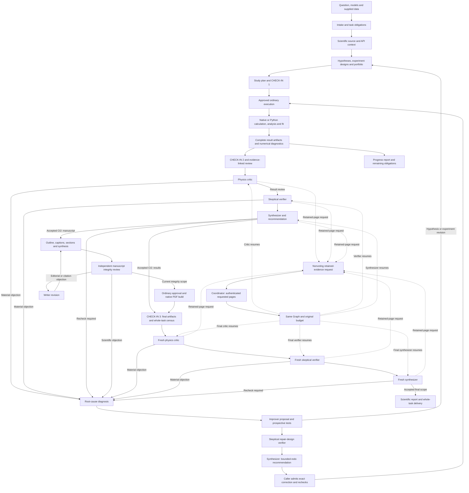
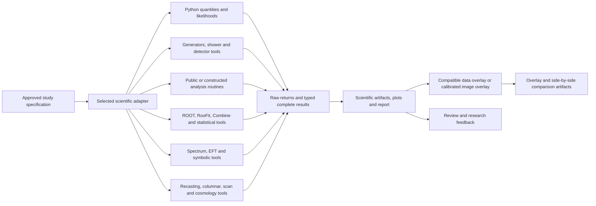

# Architecture

RAVEL joins scientific planning, tool execution and reviewed evidence in one research workflow. The original request and its deliverables remain the common reference for component studies and final synthesis.

## Overview

### Research and study loop

The default open-question coordinator uses LangGraph routing and durable SQLite checkpoints. The existing research journal and cumulative resource ledger retain scientific state, resource reservations and effect receipts; a checkpoint supplies neither approval nor acceptance. Source context informs a typed blueprint; portfolio admission and selection produce an ordinary study plan. The scientific-study executor records actual outputs and runtime. Review feeds observations, objections and revisions back into the same cycle. Result review follows critic, verifier and synthesizer. A send-back follows diagnosis, improver proposal, skeptical repair-design review and synthesizer recommendation; correction admission and the next execution are explicit caller actions.

The user selects manual decisions or explicitly delegated autonomous operation in the initial question or at CHECK-IN 1. The coordinator binds the exact instruction, original objective, named delegate and permitted plans/stages/redo ceilings. Delegated decisions are recorded as machine actions. Internal CI2 and a fresh CI3 final-result cycle remain required for research; the validated literal calculator uses its own complete calculation delivery. See [the entry procedure](../workflow/start.md#choose-manual-or-delegated-operation).

A nonvoting retained-page request returns to the coordinator. The [context-continuation interface](../workflow/reference/scientific-context-continuation.md) prepares exactly those pages in a fresh copy of the role-projected packet, then resumes the requesting role on the same Graph. The original call/output/rework ceilings, start time and campaign deadline remain unchanged. Retained catalogue custody and actually presented content stay distinct; repair and new experiments use their separate admission paths.

For manuscript delivery, the same coordinator invokes the staged writer after its selecting Graph returns. An actual outline maps claims, counterevidence, sources, quantities and figures to the sections. Citation tasks feed the ordinary literature services; caption phases present their complete native image population. Section, coherence, revision and synthesis calls retain their own source and accounting receipts. Independent integrity objections return to writer revision or to ordinary supplementary experiments. Native delivery uses the selected format and publisher assets, an ordinarily approved runtime qualification when needed, and a fresh qualified PDF build. CI3 reviews the compiled PDF and complete final population; whole-task acceptance remains a separate public check. See [staged manuscript authoring](../reference/staged-manuscript-authoring.md) and [the native delivery contract](../reference/manuscript-production.md). Results-only research retains its direct CI3 route; literal calculations retain their calculation delivery.

RDJ is the public claim-and-evidence decision graph: assertions, assumptions, evidence requests and reviewed support links. A repair records the changed slice and its required rechecks. The staged protocol retains baseline, screening, full experiments and comparison populations. Progress synthesis presents the whole current census; final synthesis uses accepted evidence and the original parent-task coverage.

## Detailed architecture

### Connected interfaces

| Layer | Implemented interface | Purpose |
|---|---|---|
| Intake | `route_prompt.route`, `capability_routing.plan`, `intake_planner`, `task_completion` | Preserve the question, bind Host planning and track original obligations across calculations, research and challenges |
| Source context | `scientific_context`, `literature_context`, `physics_knowledge`, `research_tools` | Prepare located literature, explicit extraction gaps, physics context and actual tool APIs |
| Design | `research_blueprint`, `research_followup`, `hypothesis_board`, `research_board_discussion` | Materialize supplied studies and carry explicit rival hypotheses and revisions |
| Controller | `research_orchestrator`, `langgraph_runtime`, `research_cycle`, `research_protocol` | Route decisions and resume through SQLite; retain experiment budgets, stage eligibility and feedback in the scientific journal |
| Agent/tool graph | `agent_graph`, `langchain_service`, `AgentHost` | Invoke typed charged model/tool services with bound source, schemas and call budgets |
| Study lifecycle | `science.plan`, `science.approve`, `science.run` | Review the proposed computation and execute its selected adapter under supervision |
| Scientific judgment | `scientific_judgment`, `physics_review`, `decision_case`, `scientific_autonomy` | Connect CI2, fresh CI3 and repair review to explicit manual or delegated decisions |
| Writing | `manuscript_workflow`, `manuscript_production`, `report_integrity` | Consume staged drafts and native author images; connect independent objections to revisions and experiments |
| Native publishing | `manuscript_format`, `publication_runtime`, `manuscript_build` | Bind publisher assets and runtime evidence, then build and inspect the actual PDF |
| Delivery | `scientific_artifact`, `scientific_report`, `final_results_review`, `task_completion` | Review the complete final artifacts and evaluate original whole-task coverage |

## Tool and result paths

The adapter transports the selected tool's calculation and the declared physical conventions. Full input/output populations, event weights, domains, source files and numerical settings belong to that contract. Raw returns and typed readback remain separate records. Each reported number links to its selected evidence and review scope. Figure targets use compatible quantities, units, basis, bin support and uncertainty; calibrated image placement retains a visual-only comparison. Linux ROOT/Snakemake site workflows enter through the same ordinary planning and result paths.

See [where the work runs](backends.md), [scientific studies](../workflow/reference/scientific-studies.md), [research tools](../workflow/reference/research-tools.md) and [progress and indexed review](../reference/research-progress-and-indexed-meta-review.md).

## Reading the figures

The current overview, check-in, verification, guardrail, record and backend diagrams are editable Mermaid in their Markdown pages. Boxes name implemented operations; arrows show tool handoffs and controlled feedback. The detailed step 1–8 SVG figures illustrate the event-generation/recasting tutorial: approved inputs, generation/shower, selection, figures, likelihood data, exclusion and scans. Their labeled tool alternatives belong to that selected route. The current Step 9 and cross-cutting pages connect the tutorial to scientific judgment and the wider research loop.

## The nine steps

The original event-generation and recasting tutorial remains a detailed route through the wider workflow:

| Step | Operation |
|---|---|
| [1. Environment](stage-1-environment.md) | Prepare the selected toolchain and runtime |
| [2. Inputs and route](stage-2-inputs.md) | Gather published sources and prepare the plan |
| [3. Generate](stage-3-generate.md) | Produce signal events |
| [4. Analyze](stage-4-analyze.md) | Apply detector response and selection |
| [5. Visualize](stage-5-visualize.md) | Draw the task's figures |
| [6. Acquire data](stage-6-acquire-data.md) | Obtain the likelihood, reference counts and comparison data |
| [7. Exclude](stage-7-exclude.md) | Apply the selected exclusion procedure |
| [8. Scan](stage-8-scan.md) | Evaluate the declared model-point population |
| [9. Verify](stage-9-verify.md) | Review the figures, quantities and scientific claims |

## Across all steps

[Check-ins](checkins.md), [guardrails](guardrails.md) and [records](records.md) explain the accompanying review and provenance machinery. The [third-party notices](../../THIRD-PARTY-NOTICES.md) record the licences of copied third-party files.
