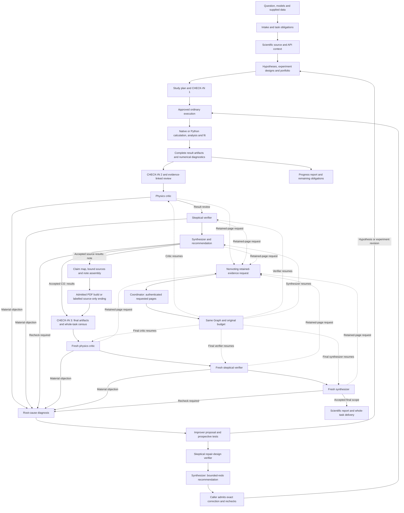

# Architecture appendix

RAVEL connects a scientific request to an approved plan, governed workers and operations, reviewed evidence and a labelled delivery. The controller keeps the original question and unfinished obligations throughout. Its software checks establish the contracts they execute; scientific validity still depends on the selected inputs, native computation and review.

| Read next | What it explains |
|---|---|
| [Controller and checkpoints](controller.md) | Routing, durable state, preparation, check-ins, authority, execution waves and bounded endings |
| [Research and knowledge](research.md) | Hypotheses, child studies, stopping judgments, lean/standard/full engagement and source-bound retrieval |
| [Scientific execution](execution.md) | Typed operations, statistics, ML, theory/event tools and batch jobs, with current integration boundaries |
| [Roles and providers](providers.md) | Role cards, seats, model preferences, worker wiring, qualification and measured usage |
| [Safety and provenance](safety.md) | Confinement, private inputs, destination policy, receipts, resume, export and restore |
| [Workflow concepts and diagrams](visual-overview.md) | Concept diagrams, vocabulary and detailed tool-layer illustrations |
| [Upstream tools and citations](upstream-tools.md) | Tool home pages, citation instructions and bibliographic data |

## Reading the figures

Boxes identify components or records. Solid arrows show a control or data handoff;
dashed arrows show a request or a conditional return. Each figure's caption states
its scope. Tutorial figures describe the selected recasting route; the controller,
research and execution pages describe the wider platform and current integration
boundaries.

## Research and review overview

Boxes name operations in the lifecycle; solid arrows show handoffs that require the selected route's admission and current evidence. Dashed arrows show a nonvoting evidence request. The caller explicitly dispatches and consumes the continued role after supplying authenticated requested pages. The same Graph retains the original call/output/rework ceilings, start time and deadline. Evidence continuation and a material-objection repair are separate paths. The manuscript branch shows the bound short-note profile; phased authoring and procedure export are separate interfaces. See [the context-continuation interface](../workflow/reference/scientific-context-continuation.md).

The diagram describes the research and result-review lifecycle. The current top-level scheduler is `controller.run`; its precise checkpoint and authority transitions are shown in [the controller appendix](controller.md). A successful native run requires the operation's actual execution and result records. The [execution appendix](execution.md) describes the implementing contracts.

## Connected layers

| Layer | Implemented interface | Purpose |
|---|---|---|
| Intake | `controller.entry`, `workflow.intake`, `route_prompt` | Retain request bytes, input classification, constraints and original deliverables |
| Source context | `knowledge_broker`, `knowledge_bundles`, `literature_serving`, `research_tools` | Serve source-bound context and located excerpts under the run's restrictions |
| Design | `research_blueprint`, `research_followup`, `hypothesis_board` | Bind explicit experiments, predictions, rival hypotheses and revisions |
| Controller | `controller.graph`, `controller.state`, `graph_substrate` | Schedule the run with durable state, waves, authority boundaries and bounded endings |
| Agent/tool graph | `controller.step`, `controller.instructions`, `controller.step.seats` | Reserve, dispatch, observe, validate and credit workers and child graphs |
| Study lifecycle | `controller.routes.study.runtime`, `science`, `stage_supervisor` | Connect approved typed studies to supervised operations and full native returns |
| Scientific judgment | `controller.judgment`, `scientific_judgment`, `rdj_loop`, `physics_review` | Check consequence, support, independent review and exact correction admission |
| Delivery | `controller.sink`, `controller.outcomes` | Recheck artifact/claim scope, render labels and derive the receipt from protected evidence |

The source and test links on each appendix page distinguish declared implementation, synthetic or stand-in software controls, and evidence that requires actual native execution. The [study-types guide](../guides/study-types.md) maps scientific intent to those contracts. The [workflow entry procedure](../workflow/start.md) remains the operational starting point.

## Detailed recasting tutorial

The step 1–8 SVG figures illustrate the event-generation/recasting tutorial. Their tool alternatives belong to the selected operation and do not define the whole platform. The current Step 9 and cross-cutting diagrams use editable Mermaid and connect that tutorial to review, authority and provenance.

| Step | Operation |
|---|---|
| [1. Environment](stage-1-environment.md) | Prepare and verify the selected runtime |
| [2. Inputs and route](stage-2-inputs.md) | Locate sources and bind the scientific plan |
| [3. Generate](stage-3-generate.md) | Produce events within approved bounds |
| [4. Analyze](stage-4-analyze.md) | Apply response and selection |
| [5. Visualize](stage-5-visualize.md) | Draw the declared quantities and comparisons |
| [6. Acquire data](stage-6-acquire-data.md) | Obtain statistical and reference inputs |
| [7. Exclude](stage-7-exclude.md) | Apply the contracted inference procedure |
| [8. Scan](stage-8-scan.md) | Evaluate and retain the complete declared domain |
| [9. Verify](stage-9-verify.md) | Review numbers, figures and claims |

[Check-ins](checkins.md), [guardrails](guardrails.md), [records](records.md) and [backends](backends.md) provide the tutorial's cross-cutting views. [Methodology](../methodology/README.md) explains the agent, research and decision laws; [third-party notices](../../THIRD-PARTY-NOTICES.md) retain copied-file licence information.
