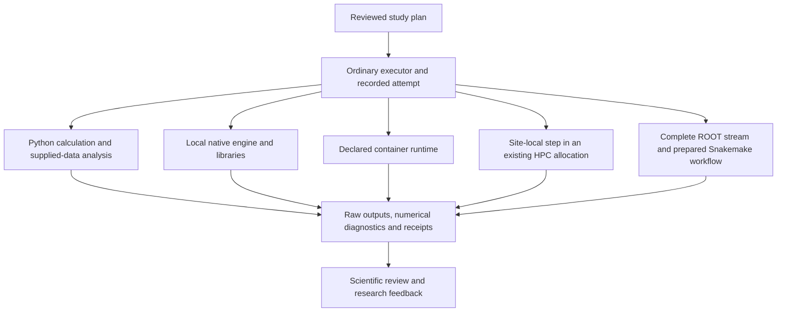

# Where the work runs

[Architecture](README.md) · [Reading the figures](README.md#reading-the-figures)

The study plan selects its Python or native toolchain, records the inputs and runtime, and declares the resource bounds. The ordinary executor supervises the selected operation and retains its raw returns and typed result artifacts.

| Route | Examples | Required setup |
|---|---|---|
| Python | Quantities, measurements, pyhf likelihoods, figures and supplied classifiers | Complete Python host and required isolated engine environments; exact input files |
| Local native | MadGraph/Pythia/Delphes, Rivet, ROOT/Combine, spectra and symbolic tools | Source, executable/library closure, settings, data and platform-specific runtime |
| Container | The MAPyDE/SimpleAnalysis comparison and declared external tool environments | The selected image and container/VM runtime with its recorded process/resource contract |
| Existing HPC allocation | CosmicIC/Nyx source-bound CPU/GPU phases | Exact private/public source closure, MPI/Slurm interfaces, cards and allocation/step ownership |
| Linux analysis site | Complete ROOT sample streams and Snakemake exports of prepared ordinary/research studies | Required separate site-analysis/site-wms environments, dataset membership, credentials, reviewed analysis/blinding sources and original approvals |

Any supervised stage can also declare an [execution backend](../reference/execution-backends.md): a native subprocess, a digest-pinned podman container, an HTCondor/SLURM job, with the same approvals, receipts and recovery. Large inputs run as checked partitions.

Columnar operations can also call the declared ServiceX endpoint with supplied dataset/query sources and access credentials. Their local process and remote request records describe separate parts of the operation.

Begin with the [ordered installation guide](../installation.md): compiler prerequisites, the full Python helper, required native engines, explicit model access and Linux site profiles. The Host supports configured Responses, Claude, Gemini and compatible Chat Completions; local models bind an explicit loopback endpoint and allowlist. Graphs preserve the selected model and cumulative call/output/time ceilings. Native installations also follow [environment setup](../workflow/steps/01-environment.md). Adapter-specific runtime declarations are in [scientific studies](../workflow/reference/scientific-studies.md), [EasyScan](../reference/parameter-space-sampling.md), [symbolic evaluation](../reference/symbolic-evaluation.md), [dataset query quantities](../reference/dataset-query-quantities.md) and [CosmicIC/Nyx](../physics/cosmic-evolution.md). See [site ROOT/Snakemake](../reference/site-workflows.md) for its ordinary handoff. Actual timing, memory and completed coverage are recorded with each study.
