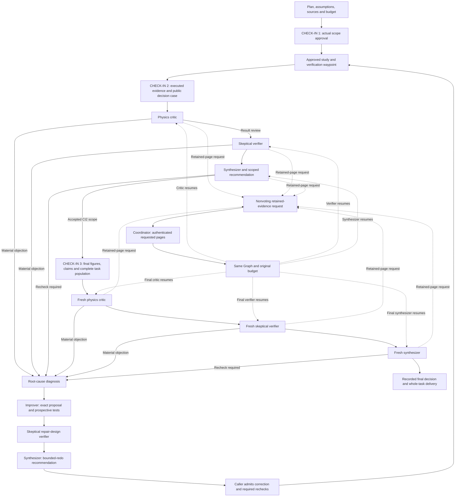

# Check-ins

[Architecture](README.md) · [Reading the figures](README.md#reading-the-figures)

Check-ins bind evidence and decisions to the original question. CHECK-IN 1 records the proposed computation, assumptions, resource budget and manual or explicitly delegated authority. CHECK-IN 2 reviews actual settings, outputs and the declared verification waypoint. CHECK-IN 3 opens fresh critic, verifier and synthesizer contexts over final research results. The same review machinery applies to a native calculation, statistical fit or constructed analysis routine.

| Check-in | Evidence and decision |
|---|---|
| CHECK-IN 1 | The plan names the task, inputs, toolchain, assumptions, checks and compute ceiling. Manual assent or the validated named delegate’s decision binds that exact scope. |
| CHECK-IN 2 | Executed settings, quantities, comparisons and diagnostics enter a bound critic–verifier–synthesizer cycle. The next action follows the declared manual or delegated authority and reviewed scope. |
| CHECK-IN 3 | Fresh role contexts review the actual final artifact, claim and original-task population after accepted CI2 evidence. Required figures and media reach the review through their declared presentation path. |
| Deviation check-in | A changed assumption, input or method is explained and recorded with its affected results and required rechecks. Execution follows the applicable approved or admitted scope. |
| Final check-in | Figures, quantities, scientific reviews and original-task coverage are presented for acceptance or further work. Progress delivery includes completed results and open obligations. |

Autonomous operation is an explicit user choice, recorded from the full initial request or actual CHECK-IN 1 response. The coordinator names the delegate and bounds its plans, stages, allowed changes and redos. Within those bounds, the machine records approval, continuation and recommendation decisions without requiring another human reply. CI2, fresh CI3, evidence requests and repair review remain internal workflow steps. Revocation and scope changes use the existing authority checks. See [manual or delegated operation](../workflow/start.md#choose-manual-or-delegated-operation).

A deviation check-in records the change and its effect on the approved scope. Work continues within that scope; a proposed scope change follows its required approval.

An evidence request is nonvoting: the existing scientific review stays pending. The coordinator uses the [retained-context procedure](../workflow/reference/scientific-context-continuation.md) to present requested pages and resume the requesting role on the same Graph with its original cumulative budget and deadline. The response and selected content remain recorded.

A send-back preserves the actual finding and spent work. The improver proposes a change; skeptical design review and the synthesizer recommendation precede explicit correction admission. The next successful attempt opens a successor review with inherited objections. Fresh role contexts bind the actual evidence and response; role declarations and model transport are recorded separately.

See the [check-in checklist](../workflow/checklists/check-ins.md), [physics-review procedure](../workflow/reference/physics-review.md), [connected judgment interface](../workflow/reference/scientific-judgment.md) and [progress/methodological review](../reference/research-progress-and-indexed-meta-review.md).
