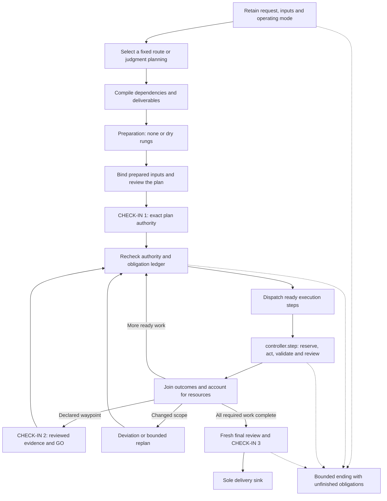

# Controller and checkpoints

The controller schedules a run from its original request to a reviewed delivery or a qualified ending. LangGraph supplies scheduling and durable checkpoints. RAVEL supplies the scientific contracts, authority checks, resource reservations and evidence needed to act.

Solid arrows show controlled handoffs. Dashed arrows show representative stop, hold or exhausted-budget exits; the implementation makes a bounded ending reachable throughout the graph. A box names a controller operation, not a promise that every scientific request completes successfully.

## State and durable records

[`controller.run`](../../src/ravel/controller/graph.py) is the top-level graph. [`RunState`](../../src/ravel/controller/state.py) carries identifiers, digests and small JSON records: request, mode, route, plan, obligations, authority, step outcomes, budget, judgments, holds and delivery. The bytes those records name live in the run store or in digest-checked artifacts. The scientific plan remains immutable; an engagement decision adds a separately pinned applied view.

[`RunStore`](../../src/ravel/controller/store.py) holds the protected controller journal, blobs and graph scope outside the worker-writable run directory. [`graph_substrate`](../../src/ravel/workflow/graph_substrate.py) provides SQLite checkpoints, thread identity, scope locks, events, stop and drain. Its serializer permits safe structured state and disables pickle fallback. A checkpoint records progress. A resume value is routing data and grants no approval.

The [`effect ledger`](../../src/ravel/workflow/effect_ledger.py) records effect identity and outcome across interruptions. An ambiguous started effect is retained for reconciliation; restarting the process does not justify repeating it. The [`execution manifest`](../../src/ravel/controller/execution_manifest.py) pins package source, installed dependency identities, Python, graph closure and thread identity before execution. Incompatible resume is refused before new admission.

## Routing and planning

The [`route selector`](../../src/ravel/controller/routes/select.py) evaluates installed route specifications in precedence order against the intake records. [`The compiler`](../../src/ravel/controller/routes/compiler.py) expands finite populations, checks the dependency graph and maps original deliverables to producers. An unmatched or open request enters [`judgment.plan`](../../src/ravel/controller/judgment/graph.py), which frames the question, reviews its framing, decomposes it and classifies consequential calls. The resulting plan preserves every requirement and records the adapter and physical inputs needed for each computation.

Preparation is a separate map node from execution. Preparation steps use `none` or `dry`, depend on preparation steps, and gather the environment, sources, declared figures, traps and cost evidence that CHECK-IN 1 presents. Generation, including a smoke run, belongs after approved execution admission. A route adapter can bind adopted preparation outputs, add check-in sections, check admission and observe outcomes. The controller retains authority and sole delivery ownership.

## Check-ins and autonomy

| Boundary | What it binds | What permits continuation |
|---|---|---|
| CHECK-IN 1 | Current plan, prepared input commitments, resource envelope and engagement decision | Verified `approve_plan` authority and the cumulative obligation gate |
| CHECK-IN 2 | A declared waypoint and its current reviewed outputs | Required credited seats followed by verified GO authority |
| Deviation | A proposed change and its effect bounds | Its own current approval; the original approval does not silently expand |
| Escalation | One question or higher-consequence action with bounded choices | A permitted answer or recorded conservative default |
| CHECK-IN 3 | Complete final population and original-task coverage | Fresh required reviews, final authority and sink checks |

[`The authority service`](../../src/ravel/controller/authority/) distinguishes physicist-in-the-loop operation from machine decisions under an operator grant. The grant freezes scope, expiry, deadlines and budgets at intake. [`Autonomy checks`](../../src/ravel/controller/authority/autonomy.py) run at start, resume, waves, check-ins and effect admission. Revocation, expiry and deadline margin end new work; pause, changed instructions and specified operational conditions wait within a bound. A terminal reply is labelled according to the identity the issuer can actually attest.

[`The obligation ledger`](../../src/ravel/controller/ledger/) derives requirements from installed catalogue data and records evidence from the actions that enforce them. Gates check cumulative transitions; the acting node rechecks and records the decision. A worker's assertion that a check passed earns no credit. A not-applicable row needs its typed reason and supporting evidence. Missing services hold transitions.

## Step and review execution

[`controller.step`](../../src/ravel/controller/step/graph.py) reserves resources, resolves the pinned role card, constructs the instruction packet, checks launch requirements, runs a worker, operation or registered child graph, observes the result, validates and adopts outputs, performs required checks and credits review. `controller.seat` applies that machinery to a review or consultation seat. Ready independent steps fan out through map nodes and join before their dependents run.

A `revise` or `unresolved` review is performed work, not acceptance. A bounded correction creates a new producer attempt with the findings pinned, then reviews the new subject. Past attempts and their spending remain. Unknown usage does not become zero. Exhausted correction, call, time or resource bounds lead to an explicit ending with the remaining obligations.

## Source and test evidence

| Source or control | Evidence type |
|---|---|
| [`controller/graph.py`](../../src/ravel/controller/graph.py), [`controller/step/graph.py`](../../src/ravel/controller/step/graph.py) | Declared graph nodes, transitions and enforcement integration |
| [`test_composition_wave_b.py`](../../tests/unit/controller/test_composition_wave_b.py) | Software composition of preparation, approval, launch, waypoint, correction and final-review transitions |
| [`test_runtime_lifecycle.py`](../../tests/unit/controller/test_runtime_lifecycle.py) | Resume identity, recovery and typed command-outcome controls |
| [`test_checkin_pin_custody.py`](../../tests/unit/controller/test_checkin_pin_custody.py) | Exact subject pins and conflicting-authority refusals |
| [`test_p18_gates.py`](../../tests/unit/controller/test_p18_gates.py) | Cold-process and current applied-plan gate controls |

These tests contain synthetic subjects and controlled workers. Their assertions establish software behavior on the corresponding source. Native scientific accuracy and whole-task autonomous success require executed scientific evaluations.

Return to the [architecture index](README.md), or continue with [research](research.md), [execution](execution.md) and [safety](safety.md).
