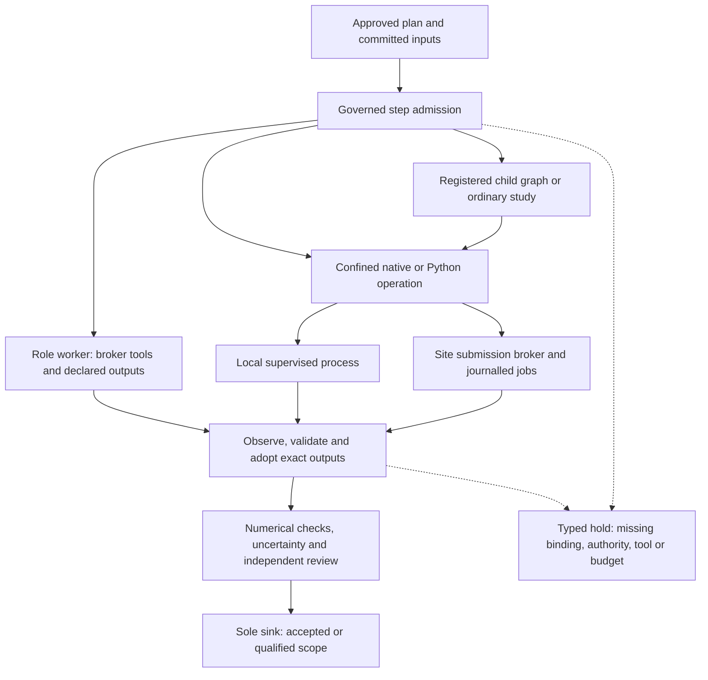

# Scientific execution

RAVEL connects approved typed operations to Python calculations, native engines and batch workflows. The operation contract determines the inputs, output population, conventions and checks. Installed code and a selected tool are prerequisites; a scientific result also needs actual execution, valid readback and review.

Solid arrows show execution and evidence handoffs; dashed arrows show holds that preserve the unmet requirement. A worker produces proposals and artifacts. The controller decides whether their outputs earn credit.

## Operation and runtime boundaries

[`Step operations`](../../src/ravel/controller/step/operations.py) resolve installed operation signatures and prepared descriptors. [`Input commitments`](../../src/ravel/controller/confine/commitments.py) bind executable, script and input bytes, including declared outputs from an approved predecessor. [`Native admission`](../../src/ravel/controller/step/launch_gate.py) checks current resources, authority, source and prospective review before a process starts. A worker-supplied command must not expand that contract.

[`The ordinary-study adapter`](../../src/ravel/controller/routes/study/runtime.py) consumes a prepared child plan and specification with exact digests. The confined child receives that study and its receipt destination; the controller retains authority and protected state. The child's own approval, runtime and review checks still apply. Scripted child assent is recorded only after verified parent CHECK-IN 1 authority; a child requiring separate human approval holds.

[`The stage supervisor`](../../src/ravel/workflow/stage_supervisor.py) records actual process attempts, resource outcomes and owned-process cleanup. [`Confinement`](../../src/ravel/controller/confine/) binds launch capabilities and the current denial-probe qualification. A process exit, validated file and accepted scientific result are separate facts. Raw native returns remain beside typed quantities and diagnostics.

The judgment planner selects tools for separate sub-problems and records their input, authority and resource requirements. [`test_composition_tool_needs.py`](../../tests/unit/controller/test_composition_tool_needs.py) checks selection and admission records.

## Statistics

An exclusion request without a prescribed statistic defaults to 95% CLs. An explicit requested statistic remains the primary quantity. Fits, measurements, propagation and efficiency studies keep their own definitions. An exclusion does not establish a discovery claim.

[`Statistical-mode selection`](../../src/ravel/workflow/stat_mode_decision.py) records the strongest applicable model available from the inputs: published likelihood, supplied simplified/covariance model, constructed likelihood, then a justified counting model. The decision records the correlation, channel-coverage and control-region inputs and their provenance.

[`The situation catalogue`](../../src/ravel/physics/inference/situations.py) detects typed conditions such as small counts, finite simulation statistics, unknown correlations, combination, look-elsewhere effects, estimation, propagation and efficiencies. It lists installed methods in cost order and attaches fact-stage and result-stage validity checks. A failing check can select a stronger applicable method, qualify the result or hold it. Automatic toy calculations require their own measured-pilot cost admission. Recorded thresholds are conventions, not universal coverage certifications.

[`The analysis route`](../../src/ravel/controller/routes/analysis/statistics.py) pins that catalogue for the seats setting the statistic, audits returned records and requires qualification labels to travel in the result. [`Uncertainty statements`](../../src/ravel/physics/inference/uncertainty.py) separate statistical, systematic and method components, mark unevaluated components and list included and omitted sources. Each uncertainty component requires numerical attachment evidence from the delivered model. Unknown-correlation endpoint calculations are a sensitivity comparison over those assumptions, not an envelope over every possible correlation law.

Python engines include pyhf, cabinetry and spey integrations. Native statistical operations preserve their own ROOT, RooFit, RooStats and Combine contracts. See [inference engines](../reference/inference-engines.md) for methods, [scope](../reference/scope.md) for quantity and fidelity rules, and [`tests/unit/test_statistics_situations.py`](../../tests/unit/test_statistics_situations.py) for software/numerical fixtures. Each model's coverage requires its own scientific evidence.

## ML inference and staged training

Applying a pinned classifier and training a new model are separate operations. Inference binds the model, features, preprocessing and event population. Staged training binds supplied data, partition/exposure rules, smoke and full training, evaluation, uncertainty and protected confirmation. [`The ML route`](../../src/ravel/controller/routes/ml/) checks those stages, original identities and exact unblind authority.

## Theory, event and analysis toolchains

Registered adapters connect model authoring and admission, symbolic calculations, amplitudes, finite integrals, spectra and decays, generation, showering, detector response and analysis. FeynRules, SARAH, FeynCalc, FORM, MadGraph, Pythia, Delphes, Rivet and SimpleAnalysis retain tool-specific source, card and runtime contracts. AgentRivet construction and SFitter agent advice/production use their declared role and native-operation interfaces. The [native tooling guide](../../native/README.md) describes installation and [scientific studies](../workflow/reference/scientific-studies.md) describes operation preparation.

[`theory_chain`](../../src/ravel/workflow/theory_chain.py) drafts stages for model admission, amplitudes, loops and widths using a supplied doctor report. Execution uses explicitly supplied stage runners. Model admission, native execution and physical applicability each require their own checks.

## Batch and site work

Snakemake and its required executor integration are part of the complete installation. [`Site observation`](../../src/ravel/workflow/site_doctor.py) and the [`run environment profile`](../../src/ravel/controller/confine/profile.py) retain tools, restrictions and the pinned site configuration. Successful execution requires the actual scheduler receipts and output readback.

For confined external workflows, [`the submission broker`](../../src/ravel/workflow/wms_broker.py) holds the controller's launch capability and accepts bounded submit, status and cancel requests over a private socket. It verifies each jobscript and submission against the approved scope, journals returned handles and permits status/cancel for those handles. The child never receives authority-store access. [`The site lifecycle`](../../src/ravel/controller/routes/study/site.py) reconciles recorded jobs, adopts verified outputs and drains work on stop or revocation; completion requires verified scheduler records and output custody.

The brokered workflow profile is HTCondor. The separate [`direct site backend`](../../src/ravel/workflow/backends/site_batch.py) supports HTCondor and Slurm. Remote job confinement follows the site's policy.

[`test_p10_broker.py`](../../tests/unit/controller/test_p10_broker.py), [`test_p10_site_batch.py`](../../tests/unit/controller/test_p10_site_batch.py) and [`test_canary_scheduler_standin.py`](../../tests/unit/test_canary_scheduler_standin.py) exercise real local sockets and scheduler stand-ins, per-submission custody, restart and drain behavior. They establish software protocol behavior. A real batch installation requires its own site qualification.

## Scientific documents

[`The manuscript route`](../../src/ravel/controller/routes/manuscript/) consumes accepted predecessor results or separately qualified supplied evidence. The note build checks a claim map against exact result digests and JSON-pointer quantities, retains declared figures and produces a source bundle followed by a bounded offline PDF build. A missing TeX engine yields a qualified source bundle; a build failure remains a failed build. Scientific acceptance requires the applicable evidence review and authority.

Return to the [architecture index](README.md), or read [safety and provenance](safety.md) and [study types](../guides/study-types.md).
