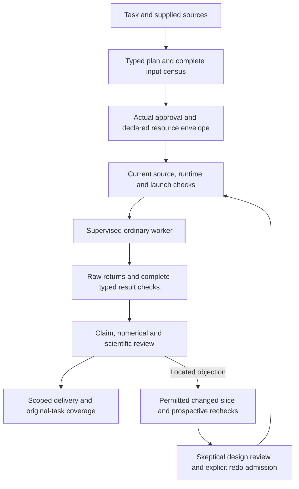

# Guardrails

[Architecture](README.md) · [Reading the figures](README.md#reading-the-figures)

RAVEL's public admission and delivery checks connect each action to its current task, source, input, approval and resource commitments. Scientific judgment adds evidence-linked claim and correction checks. Coding-agent hooks apply the corresponding controls at their configured entry points.

| Boundary | What is checked |
|---|---|
| Intake and planning | Original request, supplied inputs, source/API context and required deliverables |
| Approval and launch | Exact plan, current inputs/runtime, authorized scope and declared worker resources |
| Native and statistical execution | Selected engine, settings, whole input/output populations, physical conventions and numerical diagnostics |
| Custom routine construction | Original analysis/source assets, build/runtime inputs, selected observables and the routine's result contract |
| Graph and research work | Bound context, output schema, cumulative call budget, actual receipts and affected descendant claims |
| Correction | Located findings, permitted changed paths/stages, remaining redo budget and required rechecks |
| Reporting and reuse | Current source/evidence, accepted scope, complete requested quantities and parent-task obligations |

The ordinary study lifecycle owns computation and its supervisor records the owned attempt. The review journal owns scoped decisions and admitted corrections. A progress report retains unresolved work; a final report passes the final delivery and whole-task checks. Numerical and physics concerns remain part of the review subject.

Hook-enabled coding hosts apply session, intake, command, edit and delivery checks automatically. On other hosts, the agent follows [AGENTS.md](../../AGENTS.md), uses the public lifecycle commands and reads the refreshed status packet. The [failure catalogue](../reference/failure-modes.md), [scientific-study guide](../workflow/reference/scientific-studies.md) and [controlled correction procedure](../workflow/reference/physics-review.md) describe the exact boundaries.
