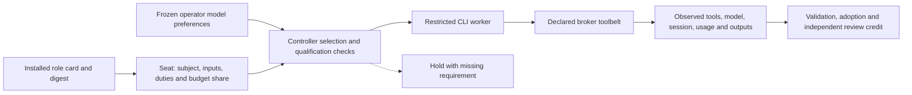

# Roles, seats and providers

A role defines a job. A seat is one invocation of that role on a particular subject. A transport carries that seat to a model. These identities remain separate so changing providers does not change a role's obligations or turn a model's self-description into evidence of independence.

Solid arrows show selection, dispatch and evidence. The dashed arrow is a refusal before a seat starts. A provider declaration, installed program, probe and live qualification are separate observations.

## Role and instruction custody

[`The effective role registry`](../../src/ravel/workflow/role_registry.py) composes the base registry and explicit registration fragments. Each card declares purpose, context view, model tier and effort, tools, budgets, outputs, ownership, consultations, escalation and reviewers. Generated host profiles describe those cards; they are guidance, not a sandbox or authority grant.

[`The card adapter`](../../src/ravel/controller/step/cards.py) resolves a canonical card against the registry digest pinned at intake. It narrows card limits by the seat's budget share, joins required card and plan outputs, checks ownership and triggers required consultations. [`Instruction delivery`](../../src/ravel/controller/instructions/) pins the role's applicable documents and checklists, presents them in its packet and validates acknowledgements against that delivery. Dependencies determine scheduling; each seat receives its declared packet and input population.

[`The engagement policy`](../../src/ravel/controller/engagement/policy.py) can fold compatible review duties into one seat. The seat retains every folded duty and the union of freshness, blindness, forbidden-input and distinct-actor constraints. Actor-independence requirements retain distinct observed actors. See [agents and roles](../methodology/agent-architecture.md) for the full role census.

## Controller worker paths

[`Controller seats`](../../src/ravel/controller/step/seats.py) use the installed `wired_transports()` inventory, protected qualification records and the selected worker contract. Restricted CLI workers use broker tools in a confined workspace.

| Path | Implementation and boundary |
|---|---|
| Claude CLI worker | Native tools disabled, strict broker MCP configuration and checked login/configuration surface; API billing also needs its enforceable finite ceiling |
| Codex subscription CLI worker | Fresh home, generated native-tool restrictions, broker MCP and observed session/model identity |

## Selection, qualification and independence

Selection intersects the role's requirements with the frozen preference order, declared model/tier mapping, supported adapter, current executable probe, provider policy and protected qualification evidence. A missing tool, structured output, effort control, identity or required isolation holds the seat. No lower model tier or weaker route silently replaces the requested one.

A CLI probe runs version/help and checks flags. Sandbox denial requires its own live qualification observation. Live qualification checks the actual tool surface, instruction delivery, output custody, session and model identity under the current executable and declaration. Controller selection reads qualification from protected controller evidence or its registered exact digest. Controller-seat qualification requires protected observations bound to the current declaration and executable.

Review independence comes from distinct observed actors and sessions, fresh workspaces and controller-built role projections. The model-family relation is recorded as same, different or unknown; different vendors are not mandatory. A producer's headline and other forbidden inputs stay outside blind review packets. Identity and independence require observations retained by the supervisor.

## Setup, usage and cost

`ravel setup-models` guides provider discovery and model preferences. The capability, balanced and economy choices are expressed through the shipped `premium`, `balanced` and `economy` presets. Discovery can adopt a local catalogue overlay; ordinary discovery and setup need no live model call. Verification is a separate opt-in conformance action with a displayed cost scenario and finite API cap.

[`The model catalogue`](../../src/ravel/workflow/model_catalogue.py) supplies explicit model capability, context/output and price information. [`Provider usage`](../../src/ravel/workflow/transports/provider_usage.py) normalizes observed counters without treating missing values as zero. API loop calls reserve a full-context/maximum-output upper bound at pinned prices before sending; missing complete usage or a matching observed model stops further calls. Tokens, catalogue-priced estimates and provider-reported billed dollars retain their own bases. [`The cost view`](../../src/ravel/controller/model_cost.py) preserves incomplete totals and source identities.

Authentication declarations contain variable names or declared credential mechanisms, never secret values. Configuration is isolated per attempt, inherited instruction/configuration surfaces are checked and credential-bearing diagnostics are sanitized. [`Provider policy`](../../src/ravel/workflow/provider_policy.py) checks the admitted destination against classified inputs before credential lookup or launch. Network enforcement scope is recorded explicitly; see [safety](safety.md).

## Source and test evidence

[`test_governed_cli_models.py`](../../tests/unit/test_governed_cli_models.py) uses controlled executable/session responses to test native-tool restrictions, subscription authentication and qualification custody. [`test_governed_loop_models.py`](../../tests/unit/test_governed_loop_models.py) uses inert local HTTP and broker fixtures to test loop launch, checkpointing, finite spend and identity controls. [`test_provider_usage.py`](../../tests/unit/test_provider_usage.py) tests counter normalization. [`test_models_setup.py`](../../tests/unit/test_models_setup.py) tests discovery, overlays and operator-ledger configuration with synthetic data. These controls establish software protocol behavior. A live provider, its billing and the current CLI installation require their own qualification evidence.

Return to the [architecture index](README.md), [research](research.md) or the [transport reference](../reference/transports.md).
