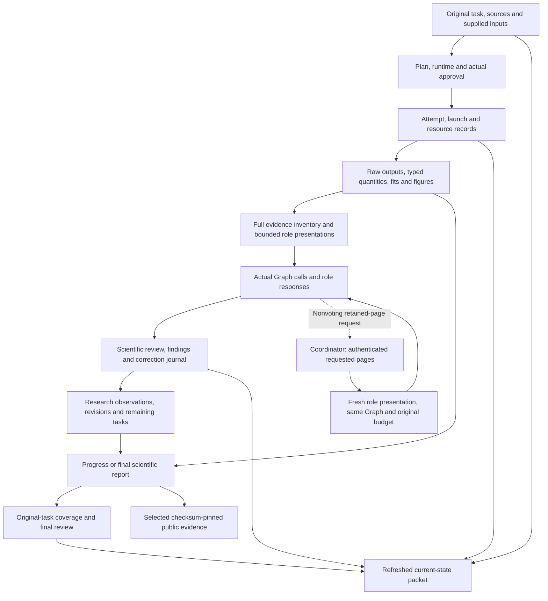

# Records and evidence

[Architecture](README.md) · [Reading the figures](README.md#reading-the-figures)

A study retains the original request, approved computation and actual attempts together. The research cycle connects those study records to hypotheses, criticism, revisions and cumulative resource use. Reports select exact quantities and reviewed evidence from this history.

`ravel status --rundir <run> --write` derives the next action from the existing records. The packet distinguishes execution, pending review, an admitted correction, progress and final delivery. Resume through that action and its recorded inputs.

| Record | Retained content |
|---|---|
| Task and plan | Original obligations, supplied sources, assumptions, tool/runtime declarations and resource ceilings |
| Execution | Exact attempt, actual launch/exit, logs, effective settings and complete input/output commitments |
| Scientific results | Quantities, units, domains, weight/covariance conventions, raw native returns and numerical status |
| Agent/tool work | Presented context, schemas, actual call receipts, role responses and cumulative expenditure |
| Review and correction | Public claims/assumptions, located findings, scoped decisions, changed paths and successor rechecks |
| Research and delivery | Hypotheses, selected studies, feedback, revisions, accepted evidence, open obligations and figure/report selectors |

A complete inventory and an actual presented page are separate records. A nonvoting request retains its actual call receipt and leaves the scientific review pending. The next selected-page packet resumes the same Graph under its original cumulative calls, output/rework limits and deadline; it records exact content rather than borrowing a prior call’s reading credit. Bounded reviewer contexts disclose large/binary omissions and provide authenticated selected pages. Reports cite the evidence actually used and its accepted scope.

Each run keeps its own records with source identity and checksum bindings. See [run-directory layout](../workflow/run-directory.md), [scientific result contracts](../reference/scientific-results.md) and [evidence contexts](../workflow/reference/physics-review.md#roles-and-evidence).
