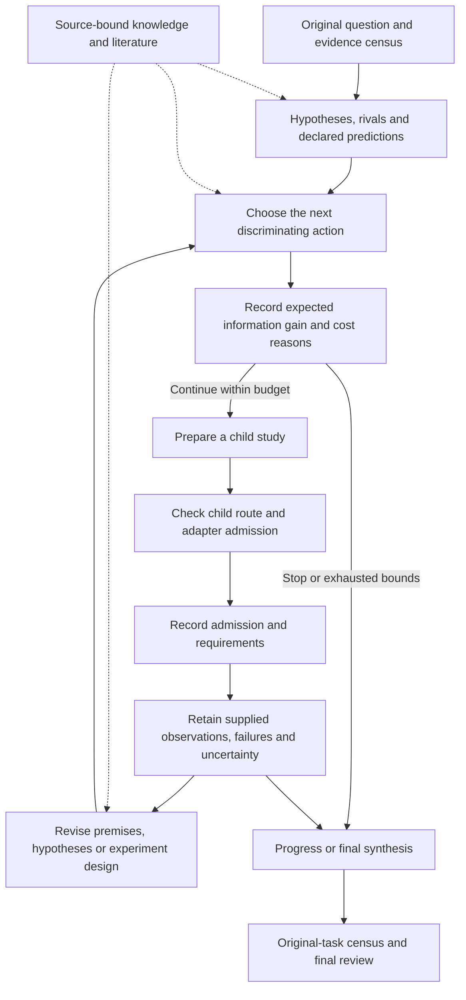

# Research, judgment and knowledge

A research campaign retains a question, rival hypotheses, experiments, observations and unresolved obligations across cycles. The controller records campaign decisions and prepares child studies under a declared budget. The evidence produced by those studies determines which scientific claims can survive review.

Solid arrows show preparation, admission records and feedback. Dashed arrows supply context. Retrieved material and model proposals are inputs to judgment. Execution authority and scientific conclusions require their applicable review and evidence.

## Campaign and child studies

[`The research route`](../../src/ravel/controller/routes/research/__init__.py) binds a campaign to this run's original task contract, adopted input pins and frozen seat preferences. [`research_controller`](../../src/ravel/workflow/research_controller.py) connects the registered research loop to governed steps. [`research_cycle`](../../src/ravel/workflow/research_cycle.py) retains hypotheses, selected experiments, observations, revision history, knowledge and synthesis.

A child experiment has its own contract, ordinary plan, inputs and checks. Its engagement is computed from its own source-backed facts rather than copied from the parent. The parent reserves its cost before admission and verifies that executed work still matches that priced reservation. Reuse requires the current source, premise and input identities; old accepted work does not authorize a changed experiment. A bounded sub-question retains its parent obligations through [`bounded_research`](../../src/ravel/workflow/bounded_research.py).

## Two distinct stopping mechanisms

[`The loop budget`](../../src/ravel/controller/routes/research/loop_budget.py) declares maximum decision cycles and children, model calls, tokens, time and cost before CHECK-IN 1. It projects the next cycle and each child at its own tier. Each action supplies an `information_gain` assessment: continue or stop, expected gain, cost justification and the identifiers of evidence actually presented. The controller checks that assessment against the chosen action before dispatch. A recorded stop prevents more cycles or children. A projected high cost that exceeds the approved remainder also stops admission.

This is a qualitative, evidence-linked judgment, not a universal numerical information-gain estimator. The research protocol's separate advisory experiment-allocation policies can rank discriminating experiments; an expected-information policy requires a pinned joint predictive law rather than agent confidence.

[`The staged protocol`](../../src/ravel/workflow/research_protocol.py) also computes stopping from preregistered success, family-coverage, round and observed-cost rules. Its purposes include baseline, screen, full evaluation, confirmation, ablation and objection tests. Exposure gates keep selection data separate from protected confirmation. Failures remain in the full trial count; a failed execution is not a refuted hypothesis. A continuation after a computed protocol stop needs its own bounded decision. See [the research methodology](../methodology/research-loop.md) for the comparison and confirmation laws.

## Engagement and proportional cost

Engagement schedules review duties while preserving the requested quantity, required tools and uncertainty-evidence obligations.

| Tier | Policy behavior |
|---|---|
| `lean` | Uses the source-checked simple-task policy and combines compatible duties into permitted seats |
| `standard` | Retains more separate review work for intermediate task facts |
| `full` | Uses the complete applicable seat plan; unknown or uncredited complexity facts select this tier |

[`The tier policy`](../../src/ravel/controller/engagement/policy.py) derives minima from route, deliverables, consequence, compute, novelty and special requirements. A request can raise engagement. Folding retains each duty's instructions and unions freshness, forbidden-input and actor-independence restrictions; incompatible duties remain separate. [`The monitor`](../../src/ravel/controller/engagement/escalation.py) raises engagement on observed failures, material review, discrepancy, scope or consequence changes. It retains cumulative spending and correction counters.

[`The envelope`](../../src/ravel/controller/engagement/envelope.py) gives low, central and high planning projections from installed calibration. The controller separately records measured usage, reservations and unknown dimensions. Projections retain their planning-estimate basis; research effectiveness requires measured scientific evaluation. [`Model cost`](../../src/ravel/controller/model_cost.py) joins provider-session usage and catalogue prices while preserving measurement gaps.

## Judgment and constructive correction

[`Judgment planning`](../../src/ravel/controller/judgment/) preserves the complete objective while framing and decomposing requests that lack a fixed route. Its protocols require located evidence, explicit assumptions and alternatives, conservative defaults and attacks on the proposed conclusion. Higher-consequence decisions require the applicable Recursive Decision Justification (RDJ) case and current authority. [RDJ](../methodology/decision-justification.md) records claim-and-evidence dependencies and reviews their support; its receipt binds the exact authorized action and gate; descendants require their applicable authority.

Scientific result review uses separate critic, verifier and decider seats. A material objection feeds diagnosis and an improver proposal, followed by repair-design verification, synthesis and explicit correction admission. A request for retained evidence is nonvoting: the coordinator supplies authenticated selected pages to the requesting role under the original Graph budget and deadline. The next dispatch and consume are explicit. Source presentation requires the actual worker packet and serving records. See [context continuation](../workflow/reference/scientific-context-continuation.md).

## Knowledge and literature retrieval

[`Knowledge bundles`](../../src/ravel/workflow/knowledge_bundles.py) materialize the role's required context, triggered lessons and check obligations. [`The source-bound broker`](../../src/ravel/workflow/knowledge_broker.py) filters source and input descriptors before serving them. The authoritative knowledge catalogue, a retrieved excerpt and a previously learned lesson retain different origins and authority. Cross-run lesson serving requires actual admitted lesson records and applicable triggers; it is not inferred from a shared directory.

The literature path consists of source acquisition and extraction, immutable indexed snapshots, retrieval and broker serving:

| Component | Contract |
|---|---|
| [`literature_corpus`](../../src/ravel/workflow/literature_corpus.py), [`literature_build`](../../src/ravel/workflow/literature_build.py) | Located source/extraction populations and build commitments |
| [`literature_index`](../../src/ravel/workflow/literature_index.py) | Lexical, dense and hierarchy-aware retrieval with explicit embedding/reranking configuration |
| [`literature_graph_retrieval`](../../src/ravel/workflow/literature_graph_retrieval.py) | Evidence-linked navigation scope plus a reserved rescue search outside that scope |
| [`literature_serving`](../../src/ravel/workflow/literature_serving.py) | Pinned provider/index, bounded serving, original excerpts and per-attempt citation checking |
| [`source_policy`](../../src/ravel/workflow/source_policy.py) | Source restrictions that apply before indexing, ranking, traversal and returned counts |

Graph paths explain navigation; the located source material supplies supporting evidence. Citations must name material actually served to that worker attempt. Excluded roots and derived-origin lineage are screened together; clean provenance requires complete lineage evidence. Discovery locates candidate sources, while scientific relevance and applicability still need review.

[`The literature tools`](../../src/ravel/workflow/research_tools.py) provide deterministic query expansion and evidence records. Model scores retain their explicit null value when the evidence record is produced by that deterministic path.

## Source and test evidence

[`test_research_information_gain.py`](../../tests/unit/controller/test_research_information_gain.py) exercises checkpointed continue/stop behavior around a real local preparation effect using controlled model responses. [`test_research_child_tier.py`](../../tests/unit/controller/test_research_child_tier.py) checks child-tier and reservation independence. [`test_composition_tiers.py`](../../tests/unit/controller/test_composition_tiers.py) covers lean, standard and full software compositions plus floor and re-review refusals. [`test_literature_controller_path.py`](../../tests/unit/test_literature_controller_path.py) covers inert retrieval, serving/citation custody and the current model-operation refusal. Research quality, retrieval performance and scientific validity require measured evaluations on the declared scientific tasks.

Return to the [architecture index](README.md), or continue with [providers](providers.md) and [execution](execution.md).
