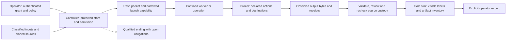

# Safety, privacy and provenance

RAVEL separates worker-writable scientific files from controller authority and evidence. It checks what a confined worker can read, write, call and launch, then reports the boundary actually established. These controls protect the governed path; an unrestricted process running as the operator remains outside that worker boundary.

Solid arrows carry admitted data, actions and evidence. Dashed arrows show a qualified ending. The worker receives its bounded task. The operator retains its key, and the controller retains its protected store and acceptance authority.

## Confinement and authority

[`The confinement package`](../../src/ravel/controller/confine/) prepares a restricted environment, qualified sandbox, pinned executable and script/input commitments. Launch capabilities name one admitted action and its bounds. [`The broker`](../../src/ravel/workflow/broker.py) exposes the declared toolbelt, validates paths and arguments and records calls. Execution requires an admitted action identity and complete launch evidence.

[`Operator authority`](../../src/ravel/controller/authority/operator.py) and [`authority issuance`](../../src/ravel/controller/authority/issuer.py) authenticate grants and decisions outside sandboxed workers. The run checks revocation, expiry, project scope, current instructions and budget at its action boundaries. A confined worker must not mint or widen the grant. An unconfined process under the same OS user can reach the operator's key; a separate OS identity or external issuer is required to close that path. Protection from that process requires the separate OS identity or external issuer.

The OS and launcher determine the actual resource and network mechanisms. Cooperative thread environment settings, process limits and aggregate memory/disk quotas are different promises. Resource admission checks the requested aggregate controls against the selected runtime. Batch jobs retain the remote site's policy boundary. See [execution](execution.md).

## Private files and classified inputs

[`Private file helpers`](../../src/ravel/workflow/private_files.py) create private files/directories before writing and preserve stricter source owner permissions when copying inputs. Supplied scientific inputs default to restricted classification. A declared project floor and each input's clearance narrow the run's provider policy; a child must not widen them.

[`Provider policy`](../../src/ravel/workflow/provider_policy.py) checks classification against declared account, endpoint and model clearance before probing, credentials or worker start. The frozen policy travels with the run. Local-only operation requires an explicit local HTTP destination and model allowlist. Credential variable names and authenticated mechanisms belong in declarations; credential values do not belong in receipts.

The endpoint the sender uses and the destination the OS filter enforces are recorded separately. A provider-port filter has port-level enforcement scope; hostname policy requires the configured sender and its destination checks. RAVEL's code-owned HTTP sender uses the configured host and refuses redirects; local Linux endpoints also need the declared port filter. Acquisition has its own [`HTTP admission`](../../src/ravel/workflow/acquisition_http.py) for initial/redirected sources, verified TLS, deadlines, byte ceilings and archive members.

## Evidence, review and delivery

[`The obligation ledger`](../../src/ravel/controller/ledger/) credits evidence written by enforcing actions. Applicable reviews bind the current subject and current attempt. Later failure, changed bytes or broken custody invalidates current credit rather than borrowing a prior pass. The source inventory and material actually presented to a reviewer remain distinct.

[`The sole sink`](../../src/ravel/controller/sink/) fixes the artifact population from the approved plan and protected custody, reads the bytes actually present, traces numerical claims and renders qualification notices itself. It checks requested statistic, fidelity, review, instruction acknowledgements and authority. Bounded delivery lists unfinished obligations and selects verified partial artifacts; it retains the verified claim scope of those artifacts.

[`The architecture receipt`](../../src/ravel/controller/sink/receipts.py) derives `architecture_complete` from named predicates: governed controller ownership, qualified confinement, intact custody, result-path obligations, credited reviews, instruction acknowledgements, authority, engagement and a sink-rendered accepted delivery. Missing observations stay unknown. An architecture receipt is a report of current evidence, not a credential that grants later authority or a certificate of physics validity. [`The legacy observer`](../../src/ravel/workflow/architecture_receipt.py) delegates controller-owned runs to this sink; other runs are labelled `NOT GOVERNED`.

[`Presentation export`](../../src/ravel/controller/sink/presentation.py) binds visible notices and detached receipt references for supported PDF, raster, SVG and TeX artifacts. Scientific binary originals retain their bytes with inventoried sidecars. Presentation admission checks the format, full page/frame population and visible labels. [`Command outcomes`](../../src/ravel/controller/outcomes.py) distinguish `delivered_accepted`, `qualified`, `held`, `refused` and `failed`; accepted delivery requires its own authenticated sink outcome.

## Resume, backup and sharing

The [`execution manifest`](../../src/ravel/controller/execution_manifest.py) verifies original source, dependency, interpreter and graph/thread identities before resume admission. Store recovery checks indexed content and interrupted writes. A changed environment needs restoration of its pinned execution context; automatic baseline adoption must not rewrite the history of an already executed run.

[`Run bundles`](../../src/ravel/controller/run_bundle.py) provide operator-authenticated, quiescent backup and read-only sharing. Restore verifies member digests, databases and authority binding and retains exact absolute locators. Arbitrary path/checkpoint migration is a separate operation, not an ordinary restore fallback.

[`Scientific sharing`](../../src/ravel/controller/sharing.py) creates a separate delivery snapshot for an explicit audience and group or public operation. Public sharing requires an explicitly public frozen classification. The export audits the receipt and copied bytes and leaves original run permissions intact. An agent session must not authorize that export by editing the run tree.

## Source and test evidence

| Controls | Evidence type |
|---|---|
| [`test_private_inputs.py`](../../tests/unit/controller/test_private_inputs.py), [`test_private_sharing.py`](../../tests/unit/controller/test_private_sharing.py) | Permissive-umask creation, classification/clearance, unchanged originals and explicit-export refusal controls |
| [`test_native_launch_gate.py`](../../tests/unit/controller/test_native_launch_gate.py), [`test_native_dispatch_gate.py`](../../tests/unit/controller/test_native_dispatch_gate.py) | Current native identity, authority and refuse-before-start controls |
| [`test_acquisition_http.py`](../../tests/unit/controller/test_acquisition_http.py) | Controlled request/redirect, TLS-policy, deadline, byte and archive tests |
| [`test_runtime_lifecycle.py`](../../tests/unit/controller/test_runtime_lifecycle.py), [`test_run_bundle.py`](../../tests/unit/controller/test_run_bundle.py) | Resume integrity, authenticated backup/restore and typed outcome controls |
| [`test_delivery_presentation.py`](../../tests/unit/controller/test_delivery_presentation.py) | Real serialized presentation formats, notice placement, unchanged source and invalid-format refusals |

These are scoped software and artifact controls. Real denial probes qualify a particular confinement setup; whole-host and remote-site enforcement require their own actual denial probes and site controls.

Return to the [architecture index](README.md), [controller](controller.md) or [providers](providers.md).
