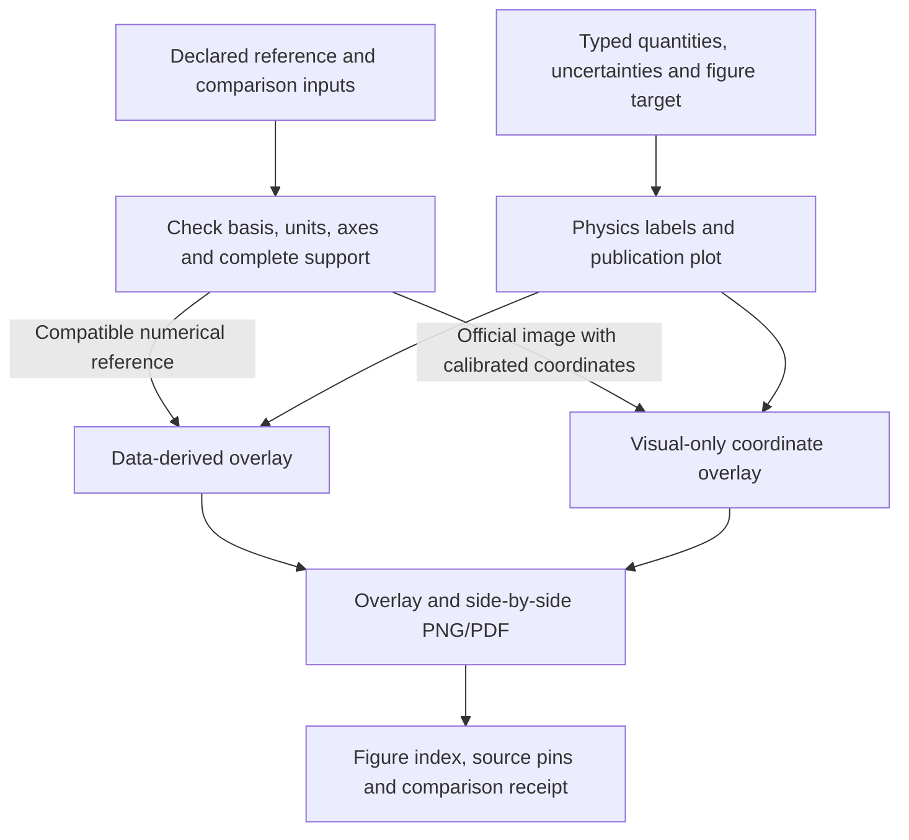

# Step 5: Visualize

[Architecture](README.md) · [Agent procedure for this step](../workflow/steps/05-visualize.md) · [Reading the figures](README.md#reading-the-figures)

Step 5 draws figures from the task’s quantities and compares them with the declared reference. Numerical overlays and calibrated image overlays accompany side-by-side views.

## Current comparison path

This path serves every declared scientific figure target.

## What goes in

- Complete typed quantities, units, bin support and uncertainty definitions.
- The figure target declared with the original task.
- Published numerical tables when available, or the official figure and its crop/axis calibration.

## What happens

1. The declared target selects the ordinary renderer and full quantity population.
2. Physics-readable labels retain mathematical notation, units and supplied uncertainty.
3. Comparable numerical references produce an overlay after basis, normalization, axes and bin-support checks.
4. An image-only reference uses its declared crop, coordinate anchors, linear/log axes and units for visual placement.
5. Overlay and side-by-side artifacts are indexed with their input and output commitments.

## What comes out

- Figures.
- A figure index.
- An overlay and a side-by-side view of the published and produced figure.
- A comparison receipt that distinguishes numerical data from calibrated visual placement.

## Checks

- The lint rejects overlapping labels, hidden data and crowded ticks.
- Every delivered figure has a caption and physics-readable labels.
- Numerical comparisons retain the admitted errors and compatible complete support.
- Image overlays retain their coordinate transform and visual-only scope.
- The declared target records the actual comparison artifacts, or its explicit missing/incomparable-reference disposition.

## When something goes wrong

- A missing numerical reference prompts source recovery or an explicit calibrated visual comparison. Different bin support, normalization or physical basis remains an applicability issue for the numerical comparison. The [figure contract](../workflow/checklists/figure-contract.md) and [plot criteria](../workflow/checklists/plot-criteria.md) define the delivered artifacts and checks.
