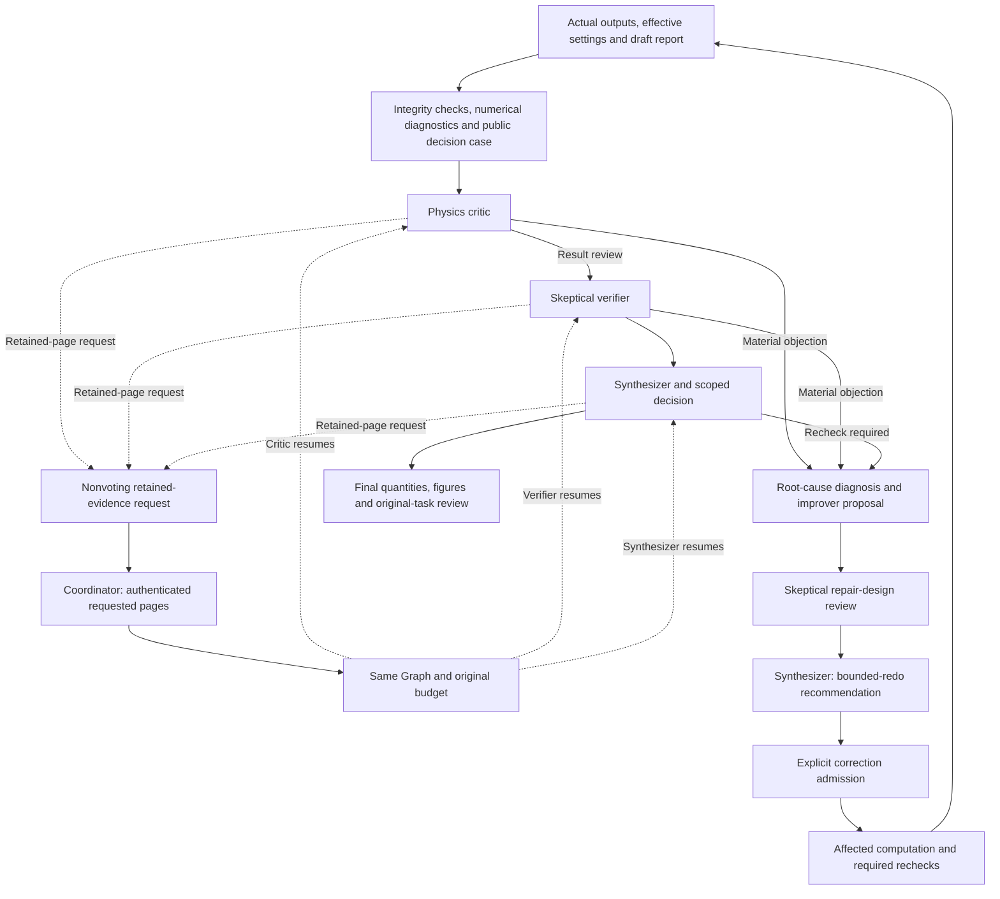

# Step 9: Verify

[Architecture](README.md) · [Agent procedure for this step](../workflow/steps/09-verify.md) · [Reading the figures](README.md#reading-the-figures)

Verification connects reported quantities to their actual computation and scientific review. This step closes the event-generation/recasting tutorial; ordinary native, statistical and custom-routine studies use the same evidence-linked review and controlled-return interfaces.

## What goes in

- The original task, review policy and actual execution records.
- Complete raw/typed outputs, effective settings, source references and numerical diagnostics.
- The draft quantities, figures and report, with located evidence selectors.

## What happens

1. The applicable lifecycle checks verify current execution, input and approval commitments.
2. Every quoted number, unit, uncertainty and figure is traced to its selected result artifact.
3. A public decision case connects claims, assumptions and support to the observed evidence.
4. Critic, skeptical verifier and synthesizer inspect their bound contexts and record scoped judgments. The tutorial's verification panel also retains its integrity, numerical and figure checks.
5. A nonvoting page request returns to the coordinator. The [retained-context procedure](../workflow/reference/scientific-context-continuation.md) adds the requested authenticated pages to a fresh role presentation and explicitly resumes that role on the same Graph and original cumulative budget/deadline.
6. A material objection returns to diagnosis and an improver proposal. Skeptical repair-design review and the synthesizer recommendation precede explicit caller admission of the affected redo and rechecks.
7. The successor review retains inherited findings and evaluates the fresh result. Whole-task review checks the original deliverables.

## What comes out

- Verification/check records and actual role responses.
- Located findings, requests for evidence, or acceptance of a named scope.
- A supported report or a concrete next experiment/correction with open tasks retained.

## Checks

Current source, raw outputs, native result populations, numerical status and reported quantities remain bound to the review. Correction paths, stages, budgets and rechecks follow the prospective policy. Figures retain their physical interpretation and source references.

## Your decision

The final check-in presents the results, evidence, uncertainties and scientific judgments against the original request. You accept the delivery or direct the next work. The [check-in page](checkins.md) describes this decision alongside progress and early verification.

## When something goes wrong

Keep the original attempt and actual finding. Prepare the affected repair or new evidence through the [scientific judgment interface](../workflow/reference/scientific-judgment.md) and [physics-review procedure](../workflow/reference/physics-review.md). Failed stages enter [diagnostic review](../workflow/reference/failed-stage-review.md); their partial evidence informs the next admitted study.
