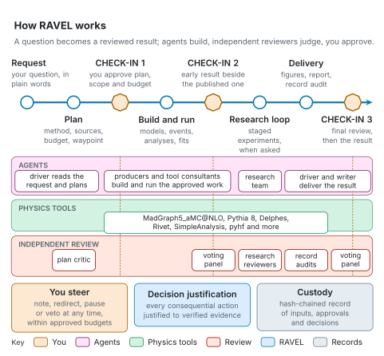

# Methodology

These pages describe how RAVEL organises agents, experiments and decisions. Each page states what the shipped
code does, with the modules that implement it.

| Page | Contents |
|---|---|
| [Agent architecture](agent-architecture.md) | The registered roles, their context and duties, independence, proportional engagement and physicist steering |
| [The research loop](research-loop.md) | Hypotheses, staged experiments with baseline, screen, full evaluation, protected confirmation, ablations and objection tests, the comparison rule and the computed stop |
| [Recursive Decision Justification](decision-justification.md) | How every consequential action is justified recursively down to verified evidence, reviewed independently, authorized by code and kept in tamper-evident custody |

<picture>
  <source media="(prefers-color-scheme: dark)" srcset="../figures/svg/dark/readme-overview.svg">
  
</picture>

Terms are defined at first use on each page and collected in a glossary at its end; the
[RAVEL glossary](../reference/glossary.md) collects them for the whole documentation.

The [architecture appendix](../architecture/README.md) connects these laws to current controller,
worker and operation code, with explicit execution boundaries and source-specific test evidence.
