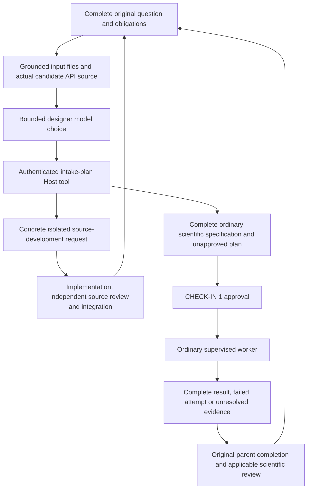

# Calculations, research questions and analysis challenges

Start with the complete question. The host agent runs `ravel initiate --prompt-file
request.txt --out <new-parent>` and reads its current-state packet. The request,
whole-task obligations and missing inputs remain available when classification needs
clarification. The host prepares the actual operation inputs and planning records;
the user supplies the question and any required scientific inputs.

A `calculation` draft preserves the numerical quantity, units and precision. Its
initial budget is zero. Compact requests such as `Compute 2+2` use the ordinary
`literal-calculation` adapter: exact decimal rational arithmetic with tracked units
(`Compute 1.2 pb * 139 fb^-1 in events`), explicit source binding, CHECK-IN 1 and the
supervised scientific worker. Literals can carry barn-family areas, inverse-area
luminosities, eV-family energies, metres and seconds with decimal prefixes; sums need
matching dimensions and a requested result unit needs the value's dimensions.
The complete prompt must match the operation. A physical lifetime, supplied
likelihood or other calculation uses its actual supplied-science contract and units.
The host keeps any missing inputs or implementation in the original goal.

A `research` draft preserves the investigation and requested final results. A search
for a new particle and a request to estimate an unknown observed significance are
research objectives. Data, backgrounds, statistical calibration and independent
review remain explicit obligations. Expected sensitivity, observed significance and
an exclusion limit are distinct quantities. A demand for a predetermined discovery
or five-sigma result supplies no scientific authority.

## Next step by kind

`inputs/intake_handoff.json` records `route`, the documented next step for the draft.
`ravel.workflow.intake.handoff_route` derives it from the intake kind:

| Kind | Route | Next step |
|---|---|---|
| `research` derived by rule D5 with no recognised shape | `open` | compose the request from the operation catalogue, using `inputs/reading.json` and the draft plan; see below |
| `research`, `method_study`, `anomaly_search` | `research` | [research coordinator](../workflow/reference/research-orchestration.md) |
| `reproduce`, `reinterpret`, `scan`, `projection`, `survey`, `summary_plot`, `no_routine` | `checkin` | resource census and route analysis in [step 2](../workflow/steps/02-inputs.md), then [CHECK-IN 1](../workflow/checklists/check-ins.md) |
| `calculation` | `calculation` | intake planner, described below |
| any kind with a named `operation` | `operation` | typed specification for a declared candidate mode, presented with `ravel plan` |
| `generate`, `likelihood` | none | [scoped workflow](../workflow/reference/scoped-workflows.md) |

The `prepare-parent` action in `inputs/capability_recovery.json` names the same route. The
`open` route reads the run's `inputs/reading.json`; `handoff_route` without the reading
returns `research`.

## Holds and gaps

A request stops only at a boundary. The reading records each boundary with its evidence and
what would make it possible:

| class | scope | example |
|---|---|---|
| `no_scientific_object` | whole request | nothing remains once negated and quoted text is removed |
| `ungrounded_identifier` | whole request | a context label that carries a scientific qualifier |
| `unsupportable_claim` | the obligations it names | a demand to claim an observed discovery |
| `inaccessible_input` | the obligations it names | private experiment data requiring authorized source custody |
| `contradiction` | the obligations it names | one span uses a source that another span forbids |
| `control_bypass_request` | one sentence | "skip the review"; it is refused and the rest proceeds |

The request is held (`unsupported`, exit 1) only when a whole-request boundary applies or the
boundaries cover every finer obligation. Otherwise the request proceeds and a boundary bounds
only its own obligations.

Everything else that is missing is a gap, not a hold. An open ambiguity row is a CHECK-IN 1
question; a physics-critical row (an unstated luminosity, a range without a step, the
construction of an Nσ prescription) is answered by the requester or a cited source, never by a
default. A missing operation, input or method stays an open obligation in the census. `ravel
initiate` prints each gap and each open row.

A host can extend the reading componently: pass a `request-reading-additions` document (facts,
constraints, deliverables and ambiguity rows with exact spans and an author envelope) as
`--interpretation`. Deleting or weakening a reader item is refused. A value marked
`user_quoted` without a matching span becomes `inferred`, and an inferred physics-critical
value gets an open ambiguity row. A delegation phrase in the request is recorded with no
authority.

Requested tools select registered operations whose signatures declare those tools and stages.
The draft preserves typed outputs and dependencies and requests missing operation inputs; an
missing tool or incompatible operation keeps a concrete development or composition gap.
Outcome-open question forms bind a research coordinator independently of template order.
Explicit publication titles are `publication_title` witnesses: their words supply no route,
parameter or statistic. Source resolution adds identifiers with receipts through the programly
reading interface. Counterfactual premises remain unverified `assumption` facts; published
measured evidence records observed-data provenance without asserting that an input was acquired.

## Named operations

Some requests ask for one concrete deliverable that needs no analysis stages. The
intake records it as `operation` on a zero-compute planning parent:

| Operation | Planning parent | Example request |
|---|---|---|
| `manuscript` | `research` | write a paper or note from accepted run results |
| `diagram` | `calculation` | enumerate or draw Feynman diagrams for a process |
| `measurement_fit` | `calculation` | fit coefficients or couplings to published measurements |
| `supplied_events` | `calculation` | run a named Rivet routine over supplied HepMC or LHE events |

A host interpretation can name the operation directly as its `kind`, or give the
planning parent as `kind` together with `operation`. The handoff lists
`candidate_modes`, the scientific modes whose declared descriptors serve the operation.
Generation requests that also name a shower, detector simulation or PDF set keep each
named stage as an explicit intake requirement for CHECK-IN 1.

Capability suggestions come from the declared descriptor of each scientific mode in
`src/ravel/data/mode_descriptors.json`: tool names, input artifact types, observable
families and output kinds. Paths, file names and quoted text are set aside before
matching; recognized file types such as `.hepmc` or `.lhe` count as inputs. A match is a
provisional candidate for host review.

Every descriptor also declares its `applicability`. A `general` operation is suggested by
its vocabulary alone. A `source-bound` operation is an adapter tied to one source's stored
population, layout or recipe. It names what it is bound to (`bound_to`), the term groups a
request must match before it is offered (`select_when`: every group, any term in it) and
the general operation to use instead (`general_operation`, or `null`). Suggestions, host
intents in `capability_routing.plan` and the operation lists of intake skip a source-bound
operation unless the request matches its predicate; a protected host intent is reported
under `withheld_candidates`. The registered predicates select an adapter by its exact
operation identifier. The CHECK-IN 1 of a source-bound study states its binding.

## Resolve a held intake in place

A request held as `needs_intent_resolution` keeps its run
directory with `request.txt`, the draft contract, capability recovery and current state.
Supply a grounded interpretation for the same request:

```sh
ravel initiate --resolve <held-run> --interpretation intent.json
```

The interpretation's `prompt_sha256` must match the retained request. The command
rewrites the intake in the same directory and keeps the previous draft, ledger and a
`resolution.json` record under `inputs/history/revision-<n>/`. It also corrects any
draft that has not reached CHECK-IN 1. When the parser is likely to miss the request,
pass `--interpretation` on the first `ravel initiate` call instead.

## Host planning and completion

The [route table](../workflow/start.md#which-route-a-request-takes) decides which planner each
kind uses. Calculations use the intake planner described here. Research, method-study and
anomaly-search parents use the [research orchestrator](../workflow/reference/research-orchestration.md).

`inputs/intake_handoff.json` binds the exact parent contract and its `original-task`
assignment. `ravel status --rundir <parent> --write` derives that handoff again.
The host supplies grounded source/input pins and finite resources to
`intake_planner.prepare`, then calls `intake_planner.graph_spec`. This produces an
actual two-node Graph using the existing Host and its cumulative call ledger:



The designer reads the selected actual API source and supplied evidence; no complete
initial study template is required. The second node consumes the actual charged
choice and prepares a fresh study through `science.plan`. Its input population,
source, goal binding and total declared attempt budget must match the request.
Scientific children retain schema-2 review policy and exact `goal_binding`.
A compact literal calculation binds the same original parent in its schema-1 task.
The tool delivers an unapproved plan; the existing approval and execution path runs it.

For a missing operation, the same tool writes concrete source targets, input/output
contracts, source evidence and positive/refusal acceptance cases. That request is
implementation work for an isolated candidate and independent review. It retains
every original obligation and returns to the parent after integration. Source work,
a proposal or one successful component does not close the whole scientific goal.

The focused public preparation commands are `ravel intake-plan prepare` and
`ravel intake-plan graph-spec`. The host writes the small evidence/resource inputs
from the actual supplied files and agreed ceilings. It executes the resulting Graph
with the configured Host, or uses its ordinary external preparation/delivery route.
The two-node planner reserves one model call and one deterministic preparation call;
its original token and wall-time ceilings remain in the same Graph. Larger native
inventories use their admitted retained-context/ordinary child preparation contracts.
This bounded planner does not clip the original goal or pretend omitted content was read.

The host can deliver the designer choice itself through the external route:

```bash
ravel agent-graph prepare-external --graph GRAPH --node choose
# the host writes its choice as RESPONSE.json, bound to the prepared request
ravel agent-graph deliver-external --graph GRAPH --node choose --response RESPONSE.json
```

Set `fresh_context` and `parent_transcript_supplied` to the actual context the host
used. A designer is a planning role, so a response written in the host's own session
is accepted. The receipt records it as `host-designed, not independent`. Critic,
verifier and other review roles still require an attested fresh context.

A delivery that fails validation leaves the node in `awaiting_external` with its
attempt intact; deliver a corrected response for the same request. When the host
fails to produce a valid response, return the node to `pending` and prepare again:

```bash
ravel agent-graph release-external --graph GRAPH --node choose --reason "why the response cannot be delivered"
```

Release refunds the node attempt and its call reservation, records the reason, and
retires the old request so that its response can no longer be delivered. Each node
can be released three times per generation.


For an actual CHECK-IN 1 response requesting autonomous operation, the coordinator
calls `intake_planner.record_checkin1_response` (or `ravel intake-plan
checkin1-response`) with the completed planning delivery and exact supplied user
text. This authenticates the actual Graph/preparation receipt and unchanged child
plan, then calls the ordinary declaration producer. It retains the response in the
existing run. `science.approve_delegated` records the separate machine decision under
those explicit bounds; no second human reply or run reinitialization is required.
An initial opt-in uses the same authority owner's prospective declaration route.
The compact calculator uses that owner's single full-context command-span parser,
so prefix and conjunction placements preserve the complete original operation.

After a literal calculation finishes, `calculation_completion.collect` binds the
actual child's approved plan, current runtime/source, completed stage, exact result
and dimensionless units to `inputs/calculation_delivery.json` in the parent.
`validate_run_state.evaluate` verifies that delivery anew. This route requires no
comparison curves, detector stages or research CI2/CI3 vote. Completion requires the full authenticated calculation-delivery record. The exact complete parent prompt determines this shortcut;
the word `calculation` alone grants no exemption. Physical and symbolic calculations
use their actual schema-2 scientific children, scoped source/quantity/unit reviews
and `inputs/task_completion.json`. The parent validates this existing whole-task
delivery through `task_completion.require_final`, including applicable final review.
It preserves the complete original request and does not demand fabricated curves.
General research and `method_study` use
`task_completion.evaluate` for progress and `require_final` for whole-parent delivery,
including the applicable final scientific review. A survey remains intermediate for
a method study. Actual comparison/T3/T9 triggers retain their basis-manifest gate.

An unresolved prompt retains `request.txt`, its contract, capability recovery and
current state before returning a held classification. A grounded interpretation
keeps the exact original text and turns that run into the corresponding planning
parent with `ravel initiate --resolve`.

## Supplied result templates

When a request supplies a numeric output template, such as a HEPData-style YAML
histogram with empty values, keep the template unchanged as part of the original
request. After the result is accepted, fill it with `ravel fill-template`; see
[result templates](../workflow/reference/result-templates.md).

## Analysis challenges

An analysis challenge or a complete new search is a `research` request. Keep the
organizer's brief, input description, submission template and rules as pinned inputs of
the original goal; their requirements, target families and stages become the task roster.
Typical obligations are a blinded selection with no signal-region data access, background
estimation and independent validation, expected sensitivity, a reproducible workflow
export, a record of prompts, models and token usage, and a written note.
A request to design a new search on supplied simulated or reconstructed samples is read this way
also when it asks for the expected discovery significance: the significance is one output of the
search, and the draft plan proposes a columnar analysis and search statistics.

Establish data access, sample membership and signal availability at the selected site.
The ntuple stages use the [columnar analysis modes](columnar-analysis-modes.md):
`ntuple-inventory` takes the supplied roster, `mc-expected-construction`, `mc-closure`
and `asimov-sensitivity` follow, `ravel site-workflow export` covers the workflow
export and `manuscript-build` the note. Credentials, downloads, signal-region access and submission each
need their own approval; signal-reinterpretation components contribute to, and do not
replace, background design and validation.
